# SISTEMA_COMPLETO — Mapa, inventario y reglas del Sistema de Incidencias

> **Documento de referencia técnica y funcional.** Reúne los diagramas del sistema, el
> inventario de vistas, modales, botones y acciones, la matriz de roles y permisos, los
> flujos principales y las **reglas estandarizadas** para crear migraciones, módulos,
> permisos, roles, vistas y operaciones CRUD.
>
> **Última revisión:** 2026-11-06 · **Versión del sistema documentada:** V2.17.0
> **Documento vivo complementario:** `PROJECT_CONTEXT.md` (esquema exacto, API detallada,
> configuración, seguridad y changelog). Este archivo no sustituye al changelog.
> **Verificación automática:** `backend/test/sistema-documentado.test.js`.
>
> Si el código y este documento discrepan, **manda el código**; corregir el documento
> forma parte del cambio, no es un paso opcional.

---

## Contenido

0. Cómo usar este documento
1. Mapa general del sistema
2. Actores, roles y alcance
3. Permisos
4. Vistas e interfaz
5. Catálogo de acciones
6. API y flujos
7. Modelo de datos
8. Reglas para las migraciones
9. Reglas para crear un módulo nuevo
10. Reglas para permisos, roles y vistas nuevas
11. Reglas de CRUD
12. ¿Es realmente necesario? Puerta de decisión
13. Ideas descartadas
14. Ideas de implementación futura
15. Apéndices (glosario, comandos, deuda técnica y changelog)

---

## 0. Cómo usar este documento

### 0.1 Qué contiene y qué no

| Contiene | No contiene |
|---|---|
| Diagramas de contexto, capas, navegación, permisos y flujos. | El detalle línea a línea de cada endpoint (ver `PROJECT_CONTEXT.md` §6). |
| Inventario de páginas, contenedores, modales, pestañas y dominios de acción. | El código fuente de las vistas o controladores. |
| Catálogo de roles, permisos, paraguas y módulos CRUD. | El historial de versiones (ver el changelog de `PROJECT_CONTEXT.md`). |
| Reglas y listas de comprobación para cambios nuevos. | Decisiones de producto ya cerradas (solo se registran en §13 y §14). |

### 0.2 Cifras de referencia

| Elemento | Cantidad | Fuente |
|---|---:|---|
| Páginas HTML (+ manifest) | 7 + 1 | `frontend/*.html`, `frontend/manifest.webmanifest` |
| Modales de la SPA | 65 | `frontend/index.html` (`div.modal-overlay`) |
| Pestañas del panel | 29 | `data-action="admin:tab"` |
| Dominios de acción registrados | 68 | `frontend/js/controllers/*.js`, `frontend/js/views/*.js` y `frontend/js/core/accesibilidad.js` |
| Acciones declaradas en el HTML | 572 atributos, 66 dominios | `frontend/index.html` |
| Roles | 11 | `backend/src/config/constantes.js` (`ROLES`) |
| Permisos | 58 | `PERMISOS` |
| Módulos CRUD | 6 | `PERMISOS_CRUD` |
| Eventos de notificación | 71 | `notificaciones.catalogo.js` |
| Migraciones | 65 | `backend/db/migrations` |
| Guías de tutorial | 58 en 10 categorías | `frontend/js/data/tutoriales.js` |

### 0.3 Regla de oro

Toda funcionalidad nueva se implementa **de fuera hacia dentro y de dentro hacia fuera a la vez**:

1. Permiso y rol (servidor) → 2. Persistencia → 3. Servicio → 4. Ruta → 5. Controlador →
6. Vista → 7. Acción de UI → 8. Pruebas → 9. Documentación.

Si se salta el paso 1, la interfaz parecerá funcionar y el servidor rechazará la operación
(o, peor, la permitirá sin control). Si se salta el paso 8, el cambio no está terminado.

### 0.4 Cómo mantenerlo

| Si cambias… | Actualiza… |
|---|---|
| Una pestaña, modal o botón | §4 y §5 |
| Un permiso, paraguas o módulo CRUD | §3 y §10 |
| Un rol o su matriz | §2, §3 y §10 |
| Una ruta o un flujo | §6 |
| Una tabla o migración | §7 y §8 |
| Las reglas de trabajo | §9, §10 y §11 |
| Una idea descartada o futura | §13 y §14 |

Después ejecuta `cd backend && node --test test/sistema-documentado.test.js`.

---

## 1. Mapa general del sistema

### 1.1 Contexto

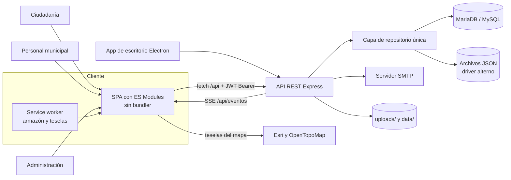

### 1.2 Capas y dependencias

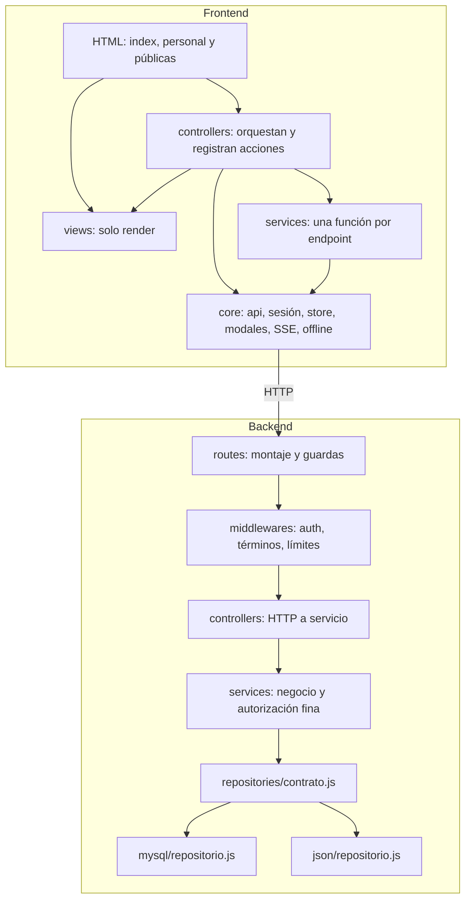

Reglas de dependencia:

- Una **vista nunca llama a la API**; solo pinta datos y emite acciones.
- Un **controlador no accede a la base**; usa un servicio del frontend.
- Un **servicio del backend no conoce HTTP**; recibe datos y devuelve resultados o errores de dominio.
- Un **router no contiene lógica**; monta, valida permisos y delega.
- Los **repositorios no conocen reglas de negocio**; ejecutan el contrato.

### 1.3 Ciclo de una petición

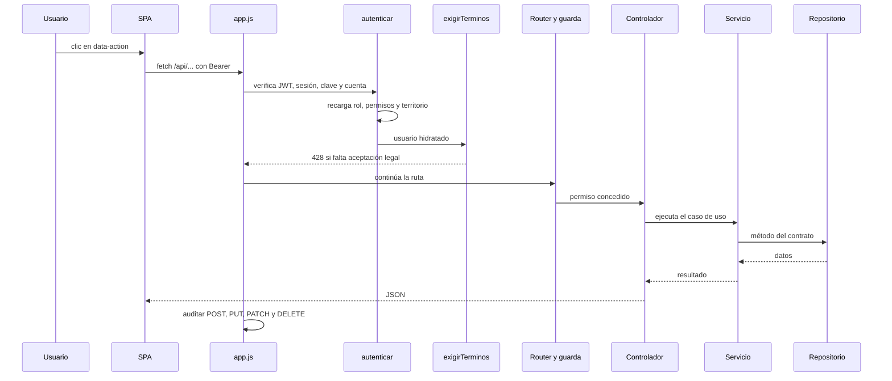

### 1.4 Tiempo real, segundo plano y offline

| Mecanismo | Dónde vive | Qué hace |
|---|---|---|
| SSE | `backend/src/services/eventos.service.js` + `frontend/js/core/tiempo-real.js` | Entrega avisos en vivo solo si se creó una fila nueva. |
| Cola de informes | `solicitudes.service.js` + `iniciarTrabajador()` | Genera PDF/CSV de solicitudes de informe. |
| Respaldos | `respaldos.service.js` + `iniciarRespaldos()` | Respaldo automático cada 30 min según configuración. |
| Muestreo | `metricas.service.js` + `iniciarMuestreo()` | Métricas de CPU y memoria del servidor. |
| Simulador | `simulacion.contexto.js` (`AsyncLocalStorage`) | Bloquea SSE y correo, etiqueta filas y permite revertir. |
| Offline | `offline.js`, `mapa-offline.js`, `sw.js` | Cola de reportes y teselas en caché con cuota y LRU. |

---

## 2. Actores, roles y alcance

### 2.1 Actores

| Actor | Cómo entra | Qué puede hacer | Qué no puede hacer |
|---|---|---|---|
| Anónimo | `POST /api/auth/anonimo` | Reportar incidencias y consultar el mapa. | Comentar, crear tickets, pedir informes, firmar o recibir avisos. |
| Ciudadano | Registro con nombre o pseudónimo y contraseña. | Reportar, comentar, firmar, crear tickets, pedir informes, contactar funcionarios, reclamar soluciones. | Entrar al panel ni ver datos de otras cuentas. |
| Personal | `/personal` con usuario y contraseña; puede requerir clave municipal. | Según rol, permisos y alcance territorial. | Salir de su ámbito ni concederse permisos. |
| Administración | `/personal` con rol `admin_*`. | Gestionar cuentas, claves, territorio y configuración según su nivel. | Un `admin_municipal` no administra otro municipio; solo el maestro tiene alcance global. |

### 2.2 Roles

| Rol | Etiqueta | Grupo | Territorio exigido | Escritura | Propósito |
|---|---|---|---|---|---|
| `anonimo` | Anónimo | — | Ninguno | No | Sesión efímera para reportar. |
| `ciudadano` | Ciudadano | `ROLES_CUENTA` | Ninguno | No | Cuenta registrada de la ciudadanía. |
| `funcionario` | Funcionario municipal | `ROLES_PERSONAL` | Municipios | Sí | Opera incidencias, tickets, reparaciones e informes de su municipio. |
| `cuadrilla` | Cuadrilla de campo | `ROLES_PERSONAL` | Municipios | Sí | Atiende las reparaciones asignadas y sube sus documentos. |
| `auditor` | Auditor | `ROLES_PERSONAL`, `ROLES_LECTURA` | Municipios o estados | No | Consulta y exporta sin modificar. |
| `enlace_estatal` | Enlace estatal | `ROLES_PERSONAL`, `ROLES_LECTURA` | Estados | No | Consulta y enlaza a nivel estatal. |
| `enlace_federal` | Enlace federal | `ROLES_PERSONAL`, `ROLES_LECTURA` | Estados | No | Consulta y enlaza a nivel federal. |
| `soporte` | Soporte técnico | `ROLES_PERSONAL`, `ROLES_ATENCION` | Municipios o estados | No | Atiende la cola de tickets. |
| `admin_municipal` | Administrador municipal | `ROLES_PERSONAL`, `ROLES_ADMIN` | Municipios | Sí | Administra su municipio. |
| `admin_estatal` | Administrador estatal | `ROLES_PERSONAL`, `ROLES_ADMIN` | Estados o municipios | Sí | Administra su estado. |
| `admin` | Administrador maestro | `ROLES_PERSONAL`, `ROLES_ADMIN` | Global | Sí | Único con alcance global y gestión de roles. |

Grupos exactos:

- `ROLES_PERSONAL`: `funcionario`, `cuadrilla`, `auditor`, `enlace_estatal`, `enlace_federal`, `soporte`, `admin_municipal`, `admin_estatal`, `admin`.
- `ROLES_ADMIN`: `admin`, `admin_estatal`, `admin_municipal`.
- `ROLES_ATENCION`: `soporte`, `admin_municipal`, `admin_estatal`, `admin`.
- `ROLES_LECTURA`: `auditor`, `enlace_estatal`, `enlace_federal`.
- `ROLES_ESCRITURA`: `cuadrilla`, `funcionario`, `admin` (declarativo; el guard real es `puedeEscribirDe`).
- `ROLES_CUENTA`: `ciudadano` + personal.
- `ROLES_EMPLEADO` y `ROLES_PERSONAL_ASIGNABLES` son alias de `ROLES_PERSONAL`.

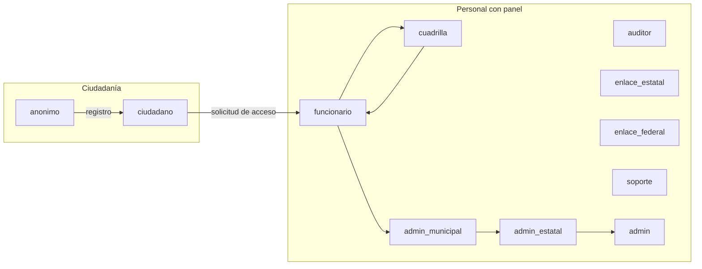

### 2.3 Escritura y alcance territorial

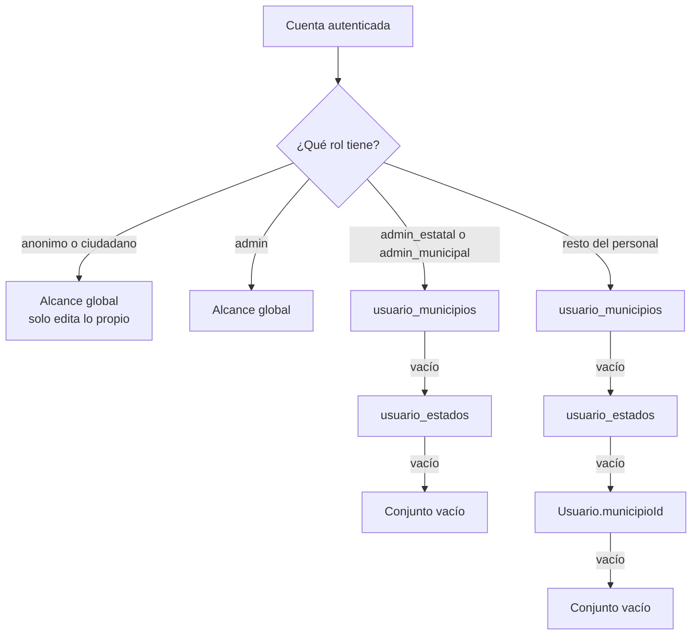

Funciones de referencia en `backend/src/services/alcance.service.js`:

| Función | Uso |
|---|---|
| `alcanceDe(usuario)` | Devuelve `{ todos, municipios, estados }`. |
| `modoDeAlcance(usuario)` | `todos`, `estados` o `municipios` para la interfaz. |
| `puedeVerMunicipio` / `puedeVerEstado` | Comprobación puntual. |
| `validarSeleccionTerritorial` | Rechaza con 403 selecciones fuera del alcance. |
| `filtrosDeAlcance` | Traduce el alcance a filtros de consulta. |
| `puedeVerIncidencia` / `exigirVisibilidad` | Visibilidad fina de una incidencia. |
| `puedeEscribirDe` | Única fuente de verdad sobre escritura. |

### 2.4 Reglas de autorización

1. El cliente **nunca** decide: `data-permiso` solo oculta; la ruta vuelve a comprobar.
2. Hay **cuatro capas** de comprobación: router, controlador/servicio, repositorio (filtros) y alcance.
3. `admin` pasa siempre `tienePermiso`; no se le recorta por matriz.
4. Un `false` explícito de la cuenta manda sobre la matriz del rol.
5. Una clave de acceso recorta territorio y permisos **en cada petición**.
6. Los permisos se recargan en cada petición; un cambio surte efecto sin volver a entrar.
7. Los roles propios **sustituyen** la matriz de su plantilla, no la suman.

---

## 3. Permisos

### 3.1 Resolución de permisos efectivos

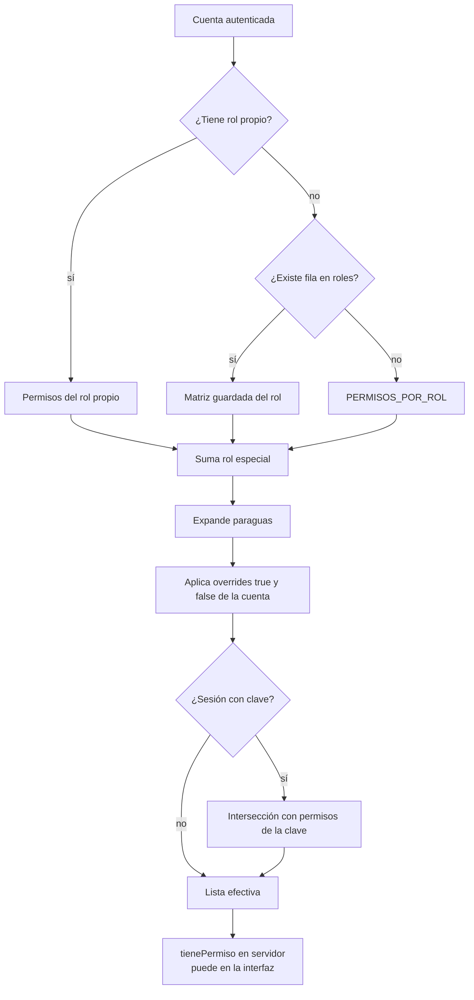

Archivos clave:

- `backend/src/config/constantes.js`: `PERMISOS`, `PERMISOS_UMBRELLA`, `PERMISOS_CRUD`, `PERMISOS_POR_ROL`.
- `backend/src/services/permisos.service.js`: `permisosDe`, `tienePermiso`, `expandirPermisos`, `permisosOtorgables`.
- `frontend/js/data/permisos.js`: espejo para pintar la matriz; **no autoriza**.

### 3.2 Catálogo de 58 permisos

| Dominio | Permisos |
|---|---|
| Incidencias | `reportar`, `editar_propios`, `cambiar_estado`, `resolver`, `moderar`, `ver_moderacion`, `exportar`, `ver_incidencias_panel`, `ver_reparaciones_panel`, `coordinar_reparaciones`, `atender_reparaciones`, `subir_documentos_reparacion`, `gestionar_vialidades` |
| Usuarios | `ver_usuarios`, `crear_usuarios`, `editar_usuarios`, `eliminar_usuarios`, `gestionar_usuarios`, `ver_solicitudes_acceso`, `aprobar_solicitudes_acceso`, `rechazar_solicitudes_acceso`, `ver_solicitudes_permisos`, `aprobar_solicitudes_permisos`, `rechazar_solicitudes_permisos`, `gestionar_solicitudes_permisos` |
| Claves | `ver_claves`, `crear_claves`, `editar_claves`, `eliminar_claves`, `gestionar_claves`, `ver_avisos_clave`, `editar_avisos_clave`, `gestionar_avisos_clave` |
| Tipos, municipios y zonas | `ver_tipos`, `crear_tipos`, `editar_tipos`, `eliminar_tipos`, `gestionar_tipos`, `ver_municipios_panel`, `ver_zonas`, `gestionar_zonas` |
| Auditoría, monitoreo y métricas | `ver_auditoria`, `ver_monitoreo`, `ver_metricas` |
| Tickets | `responder_tickets`, `atender_tickets` |
| Notificaciones | `configurar_notificaciones` |
| Firmas | `ver_firmas` |
| Administración | `revelar_password_usuarios`, `gestionar_reclamaciones`, `gestionar_solicitudes_informe`, `gestionar_legal`, `gestionar_configuracion`, `gestionar_verificacion_cuentas`, `gestionar_respaldos`, `usar_simulador`, `gestionar_publicidad`, `gestionar_correos` |

### 3.3 Permisos paraguas

| Paraguas | Se expande a |
|---|---|
| `gestionar_usuarios` | `ver_usuarios`, `crear_usuarios`, `editar_usuarios`, `eliminar_usuarios`, `ver_solicitudes_acceso`, `aprobar_solicitudes_acceso`, `rechazar_solicitudes_acceso` |
| `gestionar_claves` | `ver_claves`, `crear_claves`, `editar_claves`, `eliminar_claves` |
| `gestionar_avisos_clave` | `ver_avisos_clave`, `editar_avisos_clave` |
| `gestionar_tipos` | `ver_tipos`, `crear_tipos`, `editar_tipos`, `eliminar_tipos` |
| `gestionar_solicitudes_permisos` | `ver_solicitudes_permisos`, `aprobar_solicitudes_permisos`, `rechazar_solicitudes_permisos` |

Reglas:

- Se conserva el paraguas **y** se añaden sus hijos.
- Un `false` del paraguas elimina todo el bloque; un `true` lo concede completo.
- Un `false` concreto elimina solo ese permiso, aunque el paraguas esté activo.
- Los paraguas existen por compatibilidad: **no se crean paraguas nuevos** salvo que se migren cuentas antiguas.

### 3.4 Módulos CRUD

| Módulo | Ver | Crear | Editar | Eliminar |
|---|---|---|---|---|
| `usuarios` | `ver_usuarios` | `crear_usuarios` | `editar_usuarios` | `eliminar_usuarios` |
| `claves` | `ver_claves` | `crear_claves` | `editar_claves` (revocar) | `eliminar_claves` |
| `tipos` | `ver_tipos` | `crear_tipos` | `null` (reservado) | `eliminar_tipos` |
| `solicitudes_acceso` | `ver_solicitudes_acceso` | `null` | `aprobar_solicitudes_acceso` | `rechazar_solicitudes_acceso` |
| `avisos_clave` | `ver_avisos_clave` | `null` | `editar_avisos_clave` | `null` |
| `solicitudes_permisos` | `ver_solicitudes_permisos` | `null` | `aprobar_solicitudes_permisos` | `rechazar_solicitudes_permisos` |

### 3.5 Matriz por rol (por defecto)

| Rol | Permisos por defecto |
|---|---|
| `admin` | Los 58. |
| `admin_estatal` | `reportar`, `editar_propios`, `cambiar_estado`, `resolver`, `moderar`, `ver_moderacion`, `exportar`, `gestionar_usuarios`, `ver_usuarios`, `gestionar_claves`, `gestionar_avisos_clave`, `ver_incidencias_panel`, `ver_tipos`, `gestionar_tipos`, `ver_municipios_panel`, `ver_zonas`, `gestionar_zonas`, `ver_firmas`, `ver_monitoreo`, `responder_tickets`, `atender_tickets`, `ver_reparaciones_panel`, `coordinar_reparaciones`, `atender_reparaciones`, `subir_documentos_reparacion`, `ver_metricas`, `gestionar_vialidades`, `gestionar_solicitudes_permisos`, `revelar_password_usuarios`, `gestionar_reclamaciones` |
| `admin_municipal` | Igual que `admin_estatal` **sin** `ver_monitoreo`. |
| `funcionario` | `reportar`, `editar_propios`, `cambiar_estado`, `resolver`, `moderar`, `ver_moderacion`, `exportar`, `ver_usuarios`, `ver_incidencias_panel`, `ver_tipos`, `gestionar_tipos`, `ver_municipios_panel`, `ver_zonas`, `gestionar_zonas`, `ver_firmas`, `responder_tickets`, `ver_reparaciones_panel`, `coordinar_reparaciones`, `atender_reparaciones`, `subir_documentos_reparacion`, `ver_metricas`, `gestionar_reclamaciones` |
| `cuadrilla` | `ver_incidencias_panel`, `ver_reparaciones_panel`, `atender_reparaciones`, `subir_documentos_reparacion` |
| `auditor` | `exportar`, `ver_usuarios`, `ver_incidencias_panel`, `ver_tipos`, `ver_municipios_panel`, `ver_zonas`, `ver_moderacion`, `responder_tickets`, `ver_metricas`, `gestionar_reclamaciones` |
| `soporte` | `responder_tickets`, `atender_tickets`, `ver_incidencias_panel`, `ver_moderacion`, `ver_metricas` |
| `enlace_estatal` | `exportar`, `ver_incidencias_panel`, `ver_moderacion`, `responder_tickets`, `ver_monitoreo`, `ver_metricas` |
| `enlace_federal` | Igual que `enlace_estatal`. |
| `ciudadano` | `reportar`, `editar_propios`, `responder_tickets` |
| `anonimo` | `reportar`, `editar_propios` |

La tabla `roles` puede sobrescribir esta matriz; «Restablecer a fábrica» vuelve a
`PERMISOS_POR_ROL`. Un rol propio sustituye la matriz de su plantilla.

### 3.6 Claves de acceso

- Una clave `unica` se genera al crear la cuenta, se usa **una sola vez** para activarla y
  queda ligada a esa cuenta. La cuenta queda activa hasta `usuarios.clave_vigente_hasta`;
  al vencer, el login exige una clave nueva y la administración la renueva desde la fila
  del usuario.
- Las claves `compartida` conservan el comportamiento de las claves de municipio: pueden
  usarse en varias cuentas hasta agotar `usos_maximos` o vencer.
- Una clave guarda territorio (`clave_acceso_municipios`, `clave_acceso_estados`), permisos
  (`claves_acceso.permisos`) y vigencia.
- Al iniciar sesión con clave, la sesión adopta territorio y permisos; `autenticar` los
  reaplica en cada petición.
- `aplicarClaveAUsuario()` recorta; una clave revocada o vencida invalida la sesión.
- Los avisos por clave se limitan con `clave_notificacion_municipios`.
- El alta de personal puede partir de una clave (`claveId`): rol, territorio y permisos se
  toman de la clave, no del formulario. La edición no crea claves: solo consulta o renueva.

### 3.7 Permisos en la interfaz

| Mecanismo | Dónde | Efecto |
|---|---|---|
| `data-permiso` en pestañas | `frontend/index.html` | `PERMISO_POR_TAB` bloquea la apertura. |
| `puede('permiso')` | `frontend/js/core/` | Oculta botones y secciones. |
| `data-permiso` en otras secciones | vistas | Oculta el bloque sin permiso. |
| `usuario.permisos` | `/api/auth/me` | Lista efectiva para pintar la interfaz. |
| Guardas del servidor | rutas y servicios | **Siempre** vuelven a comprobar. |

Los tests `permisos-panel.test.js` y `sistema-documentado.test.js` validan la coherencia
entre pestañas, permisos y documentación.

---

## 4. Vistas e interfaz

### 4.1 Páginas HTML

| Archivo | Tipo | Propósito |
|---|---|---|
| `frontend/index.html` | SPA | Acceso, onboarding y aplicación completa con mapa, lista, modales y panel. |
| `frontend/personal.html` | Interna | Acceso del personal: pestaña funcionario (usuario, contraseña y clave de activación plegable) y administración. |
| `frontend/cuenta.html` | Pública | Autoservicio de cuenta: recuperar contraseña, reenviar confirmación, confirmar correo y volver al acceso. |
| `frontend/index.html#modalTickets` | Interna | Bandeja de tickets técnicos con filtros, asignación y notas internas; `/soporte` redirige aquí. |
| `frontend/solicitud-acceso.html` | Pública | Formulario de solicitud de cuenta de personal; el rol lo sugiere el servidor y lo confirma la administración. |
| `frontend/cuenta.html` | Pública | Recuperación de contraseña, confirmación de correo y vuelta al login con nombre o correo. |
| `frontend/suscripcion.html` | Pública | Alta, confirmación y baja de suscripciones de correo. |
| `frontend/legal.html` | Pública | Visor de términos y privacidad (`?doc=`). |
| `frontend/acerca.html` | Pública | Página informativa e indexable. |
| `frontend/manifest.webmanifest` | PWA | Metadatos de instalación. |

### 4.2 Contenedores principales de la SPA

| id | Propósito |
|---|---|
| `#bootScreen` | Splash único de arranque. |
| `#loginScreen` | Acceso con subpasos `#anonInicio`, `#anonLogin`, `#anonRegistro`. |
| `#onboarding` | Municipio y aceptación legal (`#obMunicipio`, `#obTerminos`). |
| `#app` | Contenedor autenticado. |
| `#sidebar` | Identidad, avisos, accesos, filtros y lista. |
| `#listaIncidencias` | Tarjetas de incidencias filtradas. |
| `#map` | Mapa Leaflet, marcadores y zonas. |
| `#notifPanel` | Panel de la campana; `#btn-notif-config` abre las preferencias personales para el personal. |
| `#infoPanel` | Leyenda del mapa. |
| `#modalAdminBox` | Caja redimensionable del panel. |

### 4.3 Barra lateral

| Grupo | Botón | Acción |
|---|---|---|
| Mi actividad | Mi cuenta y mis datos | `perfil:abrir` |
| Mi actividad | Mis folios y trámites | `folios:abrir` |
| Mi actividad | Tickets de soporte | `ticketsModal:abrir` |
| Mi actividad | Bandeja de soporte técnico | `ticketsModal:abrirAtencion` (solo quien atiende; el modal carga la pestaña) |
| Participación | Contactar a los funcionarios | `contacto:abrir` |
| Participación | Enviar una sugerencia | `sugerencias:abrir` |
| Participación | Solicitar un informe | `solicitudInforme:abrir` |
| Ayuda | ¿Cómo funciona? | `tutorial:abrir` |
| Ayuda | Enciclopedia de tutoriales | `tutorial:enciclopedia` |
| Ayuda | Términos y privacidad | `avisoLegal:abrir` |
| Ayuda | Acerca de este sistema | Enlace a `/acerca` |

Controles adicionales: filtros `#filterText`, `#filterEstado`, `#filterTipo`, `#filterColor`,
`#filterOrden`, `#filterZona`, `#filterAmbito`; `#colindantesBox`; tamaño de texto
(`accesibilidad:textoMenos`, `textoMas`, `textoRestablecer`).

### 4.4 Modales (58)

| Modal | Propósito | Acceso | Apertura |
|---|---|---|---|
| `modalTutoriales` | Enciclopedia de guías con buscador. | Sesión | `tutorial:enciclopedia` |
| `modalIncidencia` | Reportar o editar una incidencia. | `reportar` / `editar_propios` | `incidencias:reportar` |
| `modalDetalle` | Ficha, historial, comentarios (mensaje + imagen con vista previa) y adjuntos. | Sesión | `detalle:abrir` |
| `modalContacto` | Mensaje a funcionarios del municipio. | Cuenta | `contacto:abrir` |
| `modalSugerencia` | Buzón de sugerencias. | Público o sesión | `sugerencias:abrir` |
| `modalBandeja` | Bandeja de mensajería y contacto. | Personal | `bandeja:abrir` |
| `modalVisorAdjunto` | Vista previa de imagen o PDF. | Autor, participante o alcance | `bandeja:verAdjunto`, `detalle:verAdjunto` |
| `modalReporteConversacion` | Reportar un hilo. | Cuenta participante | `bandeja:reportar` |
| `modalReporteResolver` | Resolver un reporte de conversación. | `moderar` | Pestaña Conversaciones |
| `modalConversacionReporte` | Ver el contexto reportado. | `ver_moderacion` | `reporteConv:ver` |
| `modalReclamacion` | Reclamar una solución. | Cuenta registrada | `reclamacion:abrir` |
| `modalReclamacionResolver` | Resolver o delegar una reclamación. | `gestionar_reclamaciones` | `reclamacion:ver` |
| `modalRespuesta` | Responder contacto o sugerencia. | Personal | `contacto:responder` |
| `modalServidor` | Recursos del servidor. | `admin` | `servidor:abrir` |
| `modalMonitoreo` | Incidencias en vivo. | `ver_monitoreo` | `monitoreo:abrir` |
| `modalAdmin` | Panel de control con 29 pestañas. | Personal con permiso de pestaña | `admin:abrir` |
| `modalFirmaDetalle` | Firmantes de una recolección. | `ver_firmas` | Pestaña Firmas |
| `modalEnviarFirma` | Enviar documento de firmas. | `ver_firmas` | Pestaña Firmas |
| `modalRestaurarRespaldo` | Restaurar un respaldo. | `gestionar_respaldos` | Pestaña Respaldos |
| `modalCorreoInstitucional` | Alta o edición de correo. | `gestionar_correos` | `correos:nuevo` |
| `modalImportarCorreos` | Importación masiva CSV. | `gestionar_correos` | `correos:abrirImportar` |
| `modalInvitarCorreos` | Invitar a correos seleccionados. | `gestionar_correos` | `correos:invitar` |
| `modalCampana` | Editor y vista previa de campaña. | `gestionar_publicidad` | `campanas:nueva` |
| `modalSolicitudInforme` | Solicitud pública de informe. | Cuenta registrada | `solicitudInforme:abrir` |
| `modalTickets` | Crear y consultar tickets; pestaña «Bandeja de soporte» con filtros, detalle, notas internas e historial. | Cuenta registrada; bandeja solo con `atender_tickets` | `ticketsModal:abrir`, `ticketsModal:abrirAtencion` |
| `modalDemoInforme` | Demo de solicitud de informe. | Tutorial | Paso guiado |
| `modalDemoTicket` | Demo de ticket. | Tutorial | Paso guiado |
| `modalAvisosClave` | Municipios con avisos por clave. | `editar_avisos_clave` | Pestaña Avisos por clave |
| `modalSolicitudInformeDetalle` | Resumen de una solicitud. | `gestionar_solicitudes_informe` | Enlace del aviso |
| `modalVisorInforme` | Vista previa de PDF o CSV. | `gestionar_solicitudes_informe` | `solicitudesInforme:abrirPdf` |
| `modalReportes` | Constructor de informes y exportaciones. | `ver_metricas` / `exportar` | `reportes:abrir` |
| `modalElegirPdf` | Elección entre el diseño clásico y el rediseñado cuando la configuración es `preguntar`. | Personal con acceso al documento | `pdfVersion:elegir` |
| `modalRolesEspeciales` | Roles integrados, propios y especiales. | `admin` | `roles:abrir` |
| `modalPerfil` | Mi cuenta: resumen; para `ciudadano` cambio de correo/contraseña y estado de la cuenta; para personal, permisos y clave. Los bloques de personal se ocultan a ciudadanos y el anónimo ve un CTA para crear cuenta o iniciar sesión. | Sesión | `perfil:abrir` |
| `modalFichaMunicipio` | Ficha municipal y aprobación. | `ver_municipios_panel` | Fila de Municipios |
| `modalUsuario` | Alta o edición de cuenta. | `ver_usuarios` y CRUD | `admin:usuarioNuevo` |
| `modalNuevoTipo` | Alta de tipo de incidencia. | `crear_tipos` | `tipos:abrir` |
| `modalPeligro` | Marcar una incidencia como peligrosa. | `moderar` | `admin:marcarPeligro` |
| `modalResolver` | Resolver con desglose de costos y documentos. | `resolver` | `detalle:resolver` |
| `modalAsignarReparacion` | Asignar o reasignar una cuadrilla con indicaciones para el trabajo. | `coordinar_reparaciones` | `reparaciones:asignarAbrir` |
| `modalDocumentosReparacion` | Subir facturas, oficios y notas de materiales. | `subir_documentos_reparacion` | `reparaciones:documentosAbrir` |
| `modalVialidad` | Alta y edición manual de una calle, camino, carretera o autopista con eje, polígono de calzada, ancho, origen y enlace a Google Maps. | `gestionar_vialidades` | `vialidades:nueva`, `vialidades:editar` |
| `modalImportar` | Importar respaldo anterior. | `admin` | `reportes:abrirImportar` |
| `modalDenuncia` | Denunciar contenido. | Sesión | Menú de la incidencia |
| `modalModeracion` | Ocultar, advertir o suspender. | `moderar` | `moderacion:ver` |
| `modalNotifConfig` | Preferencias de avisos por evento. | `configurar_notificaciones` | `notificaciones:configurar` |
| `modalFolios` | Consulta de folios y trámites. | Sesión | `folios:abrir` |
| `modalHistorialNotif` | Historial de avisos archivados. | Sesión | `notificaciones:historial` |
| `modalTicketAdmin` | Modal heredado de gestión de un ticket; la bandeja nueva vive en `modalTickets`. | `atender_tickets` | Pestaña Tickets |
| `modalClave` | Generar clave con territorio, permisos, cupo obligatorio y vencimiento. | `crear_claves` | `claves:abrir` |
| `modalClaveGenerada` | Mostrar la clave recién creada. | `crear_claves` | Tras `claves:guardar` |
| `modalClaveUsuario` | Estado y renovación de la clave de activación de una cuenta. | Administración | `admin:claveUsuarioVer` |
| `modalRenovarClave` | Completar una clave antigua o renovar su vencimiento y cupo. | `editar_claves` | `claves:renovar` |
| `modalAprobarSolicitud` | Vincular una clave y aprobar una solicitud de acceso o alta. | Administración | `solicitudes:aprobar` |
| `modalCongelarCuenta` | Congelar la propia cuenta 7, 30 o 90 días (formulario con cuenta de solo lectura y contraseña). | Ciudadano | `cuenta:congelarAbrir` |
| `modalEliminarCuenta` | Eliminar definitivamente la cuenta y anonimizar sus datos (formulario con cuenta de solo lectura, contraseña y nombre). | Ciudadano | `cuenta:eliminarAbrir` |
| `modalPasswordUsuario` | Ver o restablecer contraseña. | `revelar_password_usuarios` | `password:ver` |
| `modalAyudaPermiso` | Explicar un permiso concreto. | Personal | Botón `?` de la matriz |
| `modalBajaUsuario` | Solicitar la baja de una cuenta. | Gestión de usuarios | `admin:usuarioEliminar` |
| `modalSolicitudPassword` | Solicitar cambio de contraseña. | Sesión | `perfil:solicitarPassword` |
| `modalSolicitudAlta` | Solicitar alta de personal. | `crear_usuarios` | `alta:solicitar` |
| `modalConfirmar` | Confirmación genérica. | Cualquiera | `dialogos.preguntar` |
| `modalCamara` | Captura de foto. | `reportar` | `incidencias:abrirCamara` |
| `modalAvisoLegal` | Visor público de términos. | Público | `avisoLegal:abrir` |
| `modalTerminos` | Editor de términos y privacidad. | `gestionar_legal` | Pestaña Legal |

### 4.5 Panel administrativo (29 pestañas)

| `data-valor` | Título | `data-permiso` | Panel |
|---|---|---|---|
| `stats` | Estadísticas | `ver_metricas` | `#panel-stats` |
| `incidencias` | Incidencias | `ver_incidencias_panel` | `#panel-incidencias` |
| `reparaciones` | Reparaciones | `ver_reparaciones_panel` | `#panel-reparaciones` |
| `tipos` | Tipos | `ver_tipos` | `#panel-tipos` |
| `municipios` | Municipios | `ver_municipios_panel` | `#panel-municipios` |
| `mapas` | Mapas sin conexión | `ver_municipios_panel` | `#panel-mapas` |
| `vialidades` | Vialidades | `gestionar_vialidades` | `#panel-vialidades` |
| `claves` | Claves de acceso | `ver_claves` | `#panel-claves` |
| `avisos-clave` | Avisos por clave | `ver_avisos_clave` | `#panel-avisos-clave` |
| `zonas` | Zonas | `ver_zonas` | `#panel-zonas` |
| `usuarios` | Usuarios | `ver_usuarios` | `#panel-usuarios` |
| `solicitudes` | Solicitudes | `ver_solicitudes_acceso` | `#panel-solicitudes` |
| `tickets` | Tickets | `atender_tickets` | `#panel-tickets` |
| `sesiones` | Conectados | `ver_monitoreo` | `#panel-sesiones` |
| `auditoria` | Auditoría | `ver_auditoria` | `#panel-auditoria` |
| `notificaciones` | Notificaciones | `configurar_notificaciones` | `#panel-notificaciones` |
| `moderacion` | Moderación | `ver_moderacion` | `#panel-moderacion` |
| `reportes-conversacion` | Conversaciones | `ver_moderacion` | `#panel-reportes-conversacion` |
| `reclamaciones` | Reclamaciones | `gestionar_reclamaciones` | `#panel-reclamaciones` |
| `archivo` | Archivo | `ver_incidencias_panel` | `#panel-archivo` |
| `firmas` | Firmas | `ver_firmas` | `#panel-firmas` |
| `solicitudes-informe` | Solicitudes de informe | `gestionar_solicitudes_informe` | `#panel-solicitudes-informe` |
| `legal` | Legal | `gestionar_legal` | `#panel-legal` |
| `configuracion` | Configuración | `gestionar_configuracion` | `#panel-configuracion` |
| `verificacion` | Acceso y verificación | `gestionar_verificacion_cuentas` | `#panel-verificacion` |
| `respaldos` | Respaldos | `gestionar_respaldos` | `#panel-respaldos` |
| `simulador` | Simulador | `usar_simulador` | `#panel-simulador` |
| `publicidad` | Publicidad y campañas | `gestionar_publicidad` | `#panel-publicidad` |
| `correos` | Correos institucionales | `gestionar_correos` | `#panel-correos` |

`PERMISO_POR_TAB` en `admin.controller.js` repite el mapeo; `permisos-panel.test.js` falla
si una pestaña y su controlador no coinciden.

### 4.6 Navegación

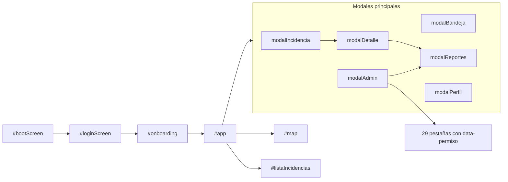

Enlaces profundos relevantes:

- `/?informe=1[&folio=…]` abre `modalSolicitudInforme`.
- `/?tickets=1[&ticket=…]` y `/?verificar=…` abren `modalTickets`; con `?ticket=` el controlador elige «Mis tickets» o la bandeja según el rol.
- `/soporte` y `/soporte.html` redirigen a `/?ticket=…` o `/?tickets=1`; ya no son vistas.
- `/?admin=<pestaña>` abre el panel; `&solicitud=`, `&baja=`, `&password=`, `&alta=`,
  `&reporte=`, `&reclamacion=` enfocan el registro concreto.
- `/?qr=<código>` abre la ficha del QR.
- `/r/<código>` redirige a la SPA.

### 4.7 Páginas públicas y flujos sin panel

| Flujo | Entrada | Salida |
|---|---|---|
| Reportar sin cuenta | Mapa y botón de reporte | Incidencia anónima con folio. |
| Consultar folio | `modalFolios` o `/?folio=` | Estado y seguimiento. |
| Sugerencia | `modalSugerencia` | Folio de sugerencia. |
| Solicitud de informe | `modalSolicitudInforme` | Folio y doble opt-in por correo. |
| Suscripción | `/suscripcion` | Confirmación y baja. |
| Solicitud de cuenta | `/solicitud-acceso` | Alta pendiente de resolución; el rol se sugiere por territorio y el correo de una cuenta ciudadana se vincula. |
| Recuperar o confirmar cuenta | `/cuenta` | Enlace por correo, nueva contraseña y vuelta al login con nombre o correo. |
| QR | `/r/<código>` | Ficha y registro de escaneo. |

### 4.8 Reglas de interfaz

1. **CSP estricta:** prohibido `style="…"`, `<style>`, `onclick` y `<script>` sin `src`.
   Los estilos dinámicos se aplican por CSSOM o clases.
2. Toda interacción usa `data-action`, `data-change`, `data-input` o `data-submit` y se
   registra con `registrarAcciones()`.
3. El contexto del manejador es `{ evento, elemento, id, valor }`; los datos extra se leen
   de `elemento.dataset.*`.
4. Los modales se abren con `abrirModal(id)`; los anidados usan `{ nested: true }`.
5. Capas fijas: login 10000, onboarding 11000, aviso legal 12000, confirmación 13000,
   carga 13900, toast 14000.
6. Para ocultar bloques alternar **clase y `hidden`**; `u-oculto` por sí solo no basta.
7. La vista no llama a la API; el controlador sí.
8. Los formularios validan en cliente, pero el servidor repite la validación.
9. Accesibilidad: foco visible, `role="status"` para mensajes, textos alternativos y
   navegación por teclado. `frontend/css/legibilidad.css` fija el mínimo de 14px de los
   textos secundarios; las utilidades `.u-fs-*` no bajan de ese valor.
10. Responsive: el panel se adapta de móvil a TV; `.admin-panel .filter-row > *` debe usar
    `flex: 0 0 auto` al apilarse.

### 4.9 Tutoriales

- `GUIA_TUTORIALES` contiene 58 guías en 10 categorías: Ciudadanía, Participación, Cuenta,
  Informes, Soporte, Mapa, Administración, Panel, Monitoreo y Permisos.
- Cada guía declara `vista: 'panel' | 'monitoreo' | 'informes'` y `tab` cuando necesita abrir
  una pestaña antes de señalar el paso.
- Cada guía incluye al menos un paso `simulacion` no destructivo.
- La bienvenida se muestra una vez por dispositivo (`inc_tutorial_bienvenida_v1`).
- Al añadir una vista o pestaña, valorar una guía nueva y registrarla en la enciclopedia.

## 5. Catálogo de acciones

### 5.1 Contrato de acciones

```html
<button data-action="dominio:accion" data-id="42" data-valor="x">Etiqueta</button>
<select data-change="dominio:accion"></select>
<input data-input="dominio:accion" />
<form data-submit="dominio:accion"></form>
```

```js
registrarAcciones({
  'dominio:accion': ({ evento, elemento, id, valor }) => { /* … */ }
});
```

Reglas:

1. El nombre siempre es `dominio:accion` en `camelCase`; el dominio agrupa una vista o módulo.
2. No se usa `onclick` ni se asignan manejadores por `addEventListener` en cada botón.
3. El contexto **solo** trae `{ evento, elemento, id, valor }`; cualquier otro dato se lee de
   `elemento.dataset.*`.
4. Una acción debe ser idempotente o confirmar antes de destruir; las acciones destructivas
   pasan por `dialogos.preguntar`.
5. Cada acción debe tener **un** manejador registrado. Si no lo tiene, `eventos.js` solo emite
   un `console.warn`, por lo que el fallo es silencioso en producción.
6. Las acciones nuevas se documentan en este capítulo y, si abren una vista, en §4.

### 5.2 Dominios registrados (68)

| Dominio | Ocurrencias | Se registra en | Responsabilidad |
|---|---:|---|---|
| `accesibilidad` | 3 | `core/accesibilidad.js` | Tamaño de texto A−, A+ y restablecer. |
| `admin` | 24 | `admin.controller.js` | Panel, pestañas, tablas, edición de usuarios y clave de activación. |
| `alta` | 4 | `admin.controller.js` | Solicitudes de alta de personal. |
| `auditoria` | 3 | `admin.controller.js` | Filtros y recarga de la bitácora. |
| `auth` | 11 | `auth.controller.js` | Acceso, registro, salida y cambio de municipio. |
| `avisoLegal` | 3 | `avisoLegal.controller.js` | Visor público de términos y privacidad. |
| `avisosClave` | 6 | `admin.controller.js` | Municipios con avisos por clave. |
| `baja` | 4 | `admin.controller.js` | Solicitudes de baja de cuentas. |
| `bandeja` | 14 | `comunicacion.controller.js` | Hilos, mensajes, contactos, bloqueos y reportes. |
| `campanas` | 20 | `campanas.controller.js` | Campañas de correo, segmentos y envíos. |
| `claves` | 7 | `admin.controller.js` | Generación, revocación y copia de claves. |
| `configuracion` | 1 | `configuracion.controller.js` | Guardar configuración global. |
| `verificacion` | 1 | `verificacion.controller.js` | Guardar activación de cuentas, tokens e inactividad. |
| `cuenta` | 5 | `perfil.controller.js` | Congelar, eliminar y solicitar la renovación de la clave propia. |
| `contacto` | 7 | `comunicacion.controller.js` | Contacto directo con funcionarios. |
| `correos` | 14 | `correosInstitucionales.controller.js` | Directorio, importación, invitación y clave. |
| `denuncia` | 2 | `moderacion.controller.js` | Denunciar contenido. |
| `detalle` | 11 | `incidencias.controller.js` | Ficha, comentarios, estado, PDF y mapa. |
| `firmas` | 5 | `incidencias.controller.js` | Firmas de una incidencia. |
| `firmasAdmin` | 8 | `firmasAdmin.controller.js` | Recolecciones y envío de documentos. |
| `folios` | 5 | `folios.controller.js` | Consulta de folios y trámites. |
| `incidencias` | 25 | `incidencias.controller.js` | Alta, edición, filtros, mapa, cámara y resolución. |
| `info` | 1 | `auth.controller.js` | Mostrar u ocultar la leyenda del mapa. |
| `legal` | 6 | `legal.controller.js` | Borrador, publicación e historial legal. |
| `lista` | 1 | `incidencias.controller.js` | Filtros de la lista lateral. |
| `mapa` | 6 | `incidencias.controller.js` | Centrar, ubicación, capas y descarga offline. |
| `mapas` | 7 | `mapas.controller.js` | CRUD de mapas descargados en el dispositivo. |
| `modal` | 1 | `incidencias.controller.js` | Cierre genérico de modales. |
| `moderacion` | 10 | `moderacion.controller.js` | Ocultar, advertir, suspender y restricciones. |
| `monitoreo` | 4 | `monitoreo.controller.js` | Refresco y filtros en vivo. |
| `municipio` | 1 | `auth.controller.js` | Cambiar el municipio activo. |
| `municipios` | 4 | `admin.controller.js` | Ficha municipal y aprobación. |
| `notificaciones` | 15 | `notificaciones.controller.js` y `auth.controller.js` | Campana, historial, preferencias y navegación al origen. |
| `notificacionesAdmin` | 3 | `admin.controller.js` | Configuración global y aviso de prueba. |
| `onboarding` | 4 | `onboarding.controller.js` | Municipio y aceptación de términos. |
| `password` | 9 | `admin.controller.js` | Ver, restablecer y resolver solicitudes. |
| `peligro` | 1 | `incidencias.controller.js` | Confirmar marca de peligro. |
| `perfil` | 4 | `perfil.controller.js` | Mi cuenta, solicitudes propias y CTA de acceso para anónimos. |
| `pdfVersion` | 2 | `versionPdf.controller.js` | Elegir o cancelar la versión del PDF cuando la configuración lo pregunta. |
| `permisos` | 3 | `admin.controller.js` | Aprobar o rechazar solicitudes de permisos. |
| `publicidad` | 30 | `publicidad.controller.js` | Estudio, publicación, QR y exportaciones. |
| `qr` | 9 | `qr.controller.js` | Generación y descarga de códigos QR. |
| `reclamacion` | 6 | `reclamaciones.controller.js` | Reclamar, decidir, delegar e informe. |
| `reclamaciones` | 2 | `reclamaciones.controller.js` | Filtros y recarga de la cola. |
| `reglas` | 3 | `admin.controller.js` | Reglas de tickets y simulación. |
| `reparaciones` | 8 | `admin.controller.js` | Bandeja de reparaciones, asignación y documentos. |
| `resolver` | 3 | `incidencias.controller.js` | Conceptos del desglose de costos al resolver. |
| `vialidades` | 8 | `vialidades.controller.js` | Catálogo administrativo, verificación, importación KML/GeoJSON y carga OSM. |
| `simulador` | 9 | `simulador.controller.js` | Acciones simuladas y simulación porcentual de vialidades. |
| `reporteConv` | 6 | `comunicacion.controller.js` y `moderacion.controller.js` | Crear, ver, resolver y revertir reportes. |
| `reportes` | 17 | `reportes.controller.js` | Constructor, gráficas y descargas. |
| `respaldos` | 8 | `respaldos.controller.js` | Crear, listar, restaurar y eliminar. |
| `respuesta` | 1 | `comunicacion.controller.js` | Responder contacto o sugerencia. |
| `roles` | 11 | `admin.controller.js` | Roles integrados, propios y especiales. |
| `servidor` | 2 | `servidor.controller.js` | Recursos del servidor. |
| `sesiones` | 1 | `admin.controller.js` | Revocar sesiones. |
| `sidebar` | 1 | `auth.controller.js` | Mostrar u ocultar la barra lateral. |
| `simulador` | 7 | `simulador.controller.js` | Abrir, ejecutar y revertir simulaciones. |
| `solicitudes` | 2 | `admin.controller.js` | Aprobar o rechazar solicitudes de acceso. |
| `solicitudesInforme` | 13 | `solicitudesInforme.controller.js` | Bandeja, visor y descarga de informes. |
| `solicitudInforme` | 5 | `solicitudInformePublica.controller.js` | Solicitud pública de informe. |
| `stats` | 2 | `admin.controller.js` | Filtros de estadísticas. |
| `sugerencias` | 3 | `comunicacion.controller.js` | Enviar y consultar sugerencias. |
| `terminos` | 3 | `terminos.controller.js` | Publicar, restaurar y ver términos. |
| `tickets` | 4 | `admin.controller.js` | Prioridad, respuesta y cierre desde el panel. |
| `ticketsAtencion` | 4 | `ticketsAtencion.controller.js` | Filtros, detalle, respuesta y cambios de la bandeja modal. |
| `ticketsModal` | 11 | `ticketsModal.controller.js` | Tickets de la ciudadanía y bandeja de soporte en el mismo modal. |
| `tipos` | 4 | `tipos.controller.js` | Alta y selección de tipos. |
| `tutorial` | 9 | `tutorial.controller.js` | Guías, pasos, enciclopedia y demos. |

> La columna «Ocurrencias» cuenta cadenas `'dominio:accion'` en controladores y vistas,
> incluidas las generadas dinámicamente. No es el número de botones del HTML.

### 5.3 Acciones clave por vista

| Vista o flujo | Acciones principales | Permiso / condición |
|---|---|---|
| Acceso | `auth:entrarAnonimo`, `auth:entrarCiudadano`, `auth:registrar`, `auth:mostrarLogin`, `auth:salir` | Público; sesión para salir. |
| Onboarding | `onboarding:continuar`, `onboarding:aceptar`, `onboarding:volver` | Sesión anónima o registrada. |
| Mapa y reporte | `incidencias:reportar`, `incidencias:guardar`, `incidencias:miUbicacion`, `incidencias:elegirMapa`, `mapa:offlineDescargar` | `reportar` / `editar_propios`. |
| Detalle | `detalle:comentar`, `detalle:archivoComentario`, `detalle:quitarAdjunto`, `detalle:verAdjunto`, `detalle:estado`, `detalle:resolver`, `detalle:pdf`, `detalle:eliminar` | Autor, `cambiar_estado`, `resolver`, `ver_incidencias_panel`, `admin`. |
| Bandeja | `bandeja:tab`, `bandeja:hilo`, `bandeja:responder`, `bandeja:bloquear`, `bandeja:reportar` | Personal o participante. |
| Contacto y sugerencias | `contacto:enviar`, `contacto:solicitarAdmin`, `sugerencias:enviar`, `respuesta:enviar` | Cuenta / personal. |
| Panel: usuarios | `admin:usuarioNuevo`, `admin:usuarioEditar`, `admin:usuarioEliminar`, `admin:usuarioReactivar`, `password:ver`, `admin:claveUsuarioVer`, `admin:claveUsuarioRenovar` | CRUD de usuarios y `revelar_password_usuarios`. |
| Panel: claves | `claves:abrir`, `claves:guardar`, `claves:copiar` | `crear_claves`. |
| Panel: tipos | `tipos:abrir`, `tipos:guardar` | `crear_tipos`. |
| Panel: municipios | `municipios:guardarFicha`, `municipios:aprobarFicha`, `municipios:rechazarFicha` | `ver_municipios_panel` y administración. |
| Panel: mapas offline | `mapas:descargar`, `mapas:actualizar`, `mapas:borrar`, `mapas:borrarTodo` | `ver_municipios_panel`. |
| Panel: auditoría y sesiones | `auditoria:filtrar`, `auditoria:limpiar`, `auditoria:recargar`, `auditoria:pdf`, `auditoria:csv`, `sesiones:revocar` | `ver_auditoria`, `ver_monitoreo`. |
| Panel: reparaciones | `reparaciones:recargar`, `reparaciones:asignarAbrir`, `reparaciones:asignarConfirmar`, `reparaciones:estado`, `reparaciones:documentosAbrir`, `reparaciones:elegirDocumentos`, `reparaciones:documentosSeleccionados`, `reparaciones:subirDocumentos` | `ver_reparaciones_panel`; escritura con `coordinar_reparaciones`, `atender_reparaciones` o `subir_documentos_reparacion`. |
| Panel: vialidades | `vialidades:filtrar`, `vialidades:limpiar`, `vialidades:nueva`, `vialidades:editar`, `vialidades:guardar`, `vialidades:verificar`, `vialidades:eliminar`, `vialidades:archivo`, `vialidades:importar`, `vialidades:importarOsm`, `vialidades:verMapa` | `gestionar_vialidades` y alcance territorial. |
| Simulación vial | `simulador:vialidades`, `simulador:vialidadesLimpiar`, `simulador:vialidadesTotal` | `usar_simulador` y administrador maestro. |
| Resolución con costos | `resolver:agregarConcepto`, `resolver:quitarConcepto`, `resolver:calcular` | `resolver`. |
| Panel: simulador | `simulador:abrir`, `simulador:cargar`, `simulador:revertirTodas` | `usar_simulador` y `admin`. |
| Panel: respaldos | `respaldos:crear`, `respaldos:confirmarRestaurar` | `gestionar_respaldos`. |
| Informes | `reportes:abrir`, `reportes:previsualizar`, `reportes:pdf`, `reportes:csv`, `reportes:imprimir` (vista heredada), `reportes:imprimible` (informe A4) | `ver_metricas` / `exportar`. |
| Moderación | `moderacion:ver`, `moderacion:decidir`, `moderacion:suspender`, `moderacion:reactivar` | `ver_moderacion` / `moderar`. |
| Conversaciones | `reporteConv:ver`, `reporteConv:resolver`, `reporteConv:revertir` | `ver_moderacion` / `moderar`. |
| Reclamaciones | `reclamacion:abrir`, `reclamacion:enviar`, `reclamacion:confirmar`, `reclamacion:delegar` | Cuenta / `gestionar_reclamaciones` / administración. |
| Cuenta | `perfil:abrir`, `perfil:irAlLogin`, `perfil:solicitar`, `perfil:solicitarPassword` | Sesión; `perfil:irAlLogin` cierra el modal y abre el acceso o el registro. |
| PDF | `pdfVersion:elegir`, `pdfVersion:cerrar` | Personal con acceso al documento; resuelve la versión elegida. |
| Tutorial | `tutorial:abrir`, `tutorial:siguiente`, `tutorial:anterior`, `tutorial:demoCerrar` | Sesión. |
| Accesibilidad | `accesibilidad:textoMas`, `accesibilidad:textoMenos`, `accesibilidad:textoRestablecer` | Sesión; preferencia local. |

### 5.4 Eventos de interfaz y enlaces profundos

- SSE: `GET /api/eventos` mantiene la campana al día; el clic lleva al origen mediante
  `navegarAlOrigen()`.
- Avisos con `url`: `panel=<pestaña>` más `solicitud`, `baja`, `password`, `alta`, `reporte`
  o `reclamacion` según el evento.
- `?informe=1`, `?tickets=1`, `?verificar=`, `?folio=`, `?qr=` y `?contacto=` abren el modal
  correspondiente al cargar la SPA.
- La cola offline guarda reportes sin conexión en IndexedDB y los reenvía al recuperar red.

### 5.5 Reglas para acciones nuevas

1. Nombrar `dominio:verbo` en `camelCase`; el verbo describe la intención, no el elemento.
2. Registrar el manejador en el controlador del dominio, no en `main.js`.
3. Si la acción abre un modal, cerrar el anterior o usar `nested` cuando corresponda.
4. Si la acción es destructiva, pedir confirmación y refrescar la vista después.
5. Si la acción requiere un permiso, ocultar el botón **y** comprobarlo en el servidor.
6. Si la acción cambia datos, registrar auditoría y valorar un evento de notificación.
7. Añadir la acción a este capítulo y, si aplica, a una guía de tutorial.

---

## 6. API y flujos

### 6.1 Convención REST

| Verbo | Uso | Respuesta habitual |
|---|---|---|
| `GET` | Lectura con filtros y alcance. | `200` con lista o entidad. |
| `POST` | Crear o ejecutar una acción. | `201` con la entidad; `200` en acciones. |
| `PATCH` | Cambio parcial de estado o campos. | `200` con la entidad actualizada. |
| `PUT` | Reemplazo o guardado completo. | `200`. |
| `DELETE` | Baja lógica o eliminación de catálogo. | `200` o `204`. |

Prefijos: `/api/auth`, `/api/publico`, `/api/admin` y el resto bajo `/api`. Los routers de
administración se montan en la raíz para no bloquear otras rutas; **cada ruta** lleva su
guarda (`requierePermiso`, `requiereAdmin` o `requiereAlgunaAdmin`), no un `router.use`
global salvo que todo el prefijo sea administrativo.

### 6.2 Endpoints por módulo

| Módulo | Endpoints representativos | Autorización |
|---|---|---|
| Auth | `POST /api/auth/anonimo`, `/registro`, `/ciudadano`, `/funcionario`, `/admin`; `GET /api/auth/me`; `POST /api/auth/salir` | Público con límites; `me` y `salir` con sesión. |
| Catálogos | `GET /api/catalogos`, `/api/publico/municipios`, `/api/publico/tipos`, `/api/municipios` | Público / sesión. |
| Incidencias | `GET/POST /api/incidencias`, `GET /api/incidencias/mapa`, `/vialidades`, `/archivo`, `/:id`, `/expediente`, `/:id/pdf`, `PUT /:id`, `PATCH /:id/estado`, `/peligro`, `POST /:id/resolucion`, `DELETE /:id` | `reportar`, `editar_propios`, `cambiar_estado`, `moderar`, `resolver`, `ver_incidencias_panel`, `admin`. |
| Reparaciones de campo | `GET /api/incidencias/reparaciones`, `/reparaciones/cuadrillas`; `POST /:id/asignar`; `PATCH /:id/reparacion`; `POST /:id/reparacion/documentos` | `ver_reparaciones_panel`, `coordinar_reparaciones`, `atender_reparaciones`, `subir_documentos_reparacion`. |
| Condición de vialidades | `GET /api/incidencias/vialidades?municipio=&bbox=&desde=&hasta=` | Sesión no anónima; devuelve `vias`, `zonas`, `resumen` y la escala de cinco colores. |
| Catálogo administrativo de vialidades | `GET/POST /api/admin/vialidades`; `PATCH/DELETE /:id`; `POST /:id/verificar`; `POST /importar`; `POST /importar-osm` | `requiereAlgunaAdmin` + `gestionar_vialidades` y alcance territorial. `importar` acepta KML o GeoJSON con líneas/polígonos y fusiona por osm_id/clave; `importar-osm` descarga la red vehicular real de OpenStreetMap. |
| Simulación vial | `POST /api/admin/simulador/vialidades` | `requiereAdmin` + `usar_simulador`; recibe porcentajes que suman 100 y devuelve copias coloreadas sin persistir. |
| Auditoría | `GET /api/admin/auditoria?metodo=&username=&accion=&desde=&hasta=`; `GET /api/admin/auditoria/informe?formato=pdf|csv` | `ver_auditoria`; el informe usa los mismos filtros de fecha (`AAAA-MM-DD`), tipo y autor. |
| Archivo y expediente | `GET /api/incidencias/archivo`; `GET /api/incidencias/:id/expediente`; `GET /api/incidencias/:id/expediente/pdf` | `ver_incidencias_panel` y alcance territorial; el archivo se agrupa por mes y día. |
| Comentarios y adjuntos | `GET/POST /api/incidencias/:id/comentarios`, `DELETE .../:comentarioId`; `POST /api/adjuntos`, `/comentario`; `GET /api/adjuntos/:id` | Sesión; autor o participante; cuenta para comentar. El `POST` responde 409 con `reintentarEn` durante la espera anti-spam y el detalle expone `permisos.comentario`. |
| Firmas | `GET/POST /api/incidencias/:id/firmas`, `PATCH .../meta-firmas`, `POST .../solicitar`; `GET/POST /api/firmas/municipio` | Sesión; `ver_firmas` para administración. |
| Folios | `GET /api/folios/mios`, `/api/folios/:folio`; `GET /api/admin/folios` | Sesión; admin. |
| Reclamaciones | `POST /api/incidencias/:id/reclamaciones`; `GET /api/reclamaciones`, `/:id`, `/:id/informe`; `PATCH /:id/delegar`, `/:id/resolver` | Cuenta; `gestionar_reclamaciones`; administración para delegar. |
| Tickets | `GET/POST /api/tickets`, `GET /:id`, `POST /:id/mensajes`, `PATCH /:id/estado`, `/:id/asignacion`, `/:id/prioridad`; reglas en `/api/admin/tickets/reglas` | Cuenta; autor o `atender_tickets`; reglas solo `admin`. |
| Moderación | `POST /api/incidencias/:id/denuncias`; `GET /api/moderacion/denuncias`, `/resumen`, `/cuentas`; `PATCH /api/moderacion/denuncias/:id`; acciones de ocultar, advertir, suspender y restringir | `ver_moderacion` / `moderar`. |
| Conversaciones | `GET/POST /api/reportes-conversacion`, `/contexto`; `PATCH /:id/resolver`, `/:id/revertir` | Participante; `ver_moderacion` / `moderar`. |
| Bloqueos | `GET/POST/DELETE /api/bloqueos` | Sesión. |
| Usuarios | `GET/POST /api/usuarios`, `PATCH /:id`, `DELETE /:id`, `POST /:id/reactivar`; `GET /:id/password`, `POST /:id/password/restablecer`; `GET /:id/clave`, `POST /:id/clave/renovar` | CRUD de usuarios; `revelar_password_usuarios`; administración para la clave. |
| Cuenta propia | `GET /api/cuenta`, `/clave`; `POST /api/cuenta/correo`, `/password`, `/congelar`, `/eliminar`, `/clave/solicitar-renovacion` | Sesión; `/correo` y `/password` solo ciudadanos y exigen contraseña; congelar/eliminar solo ciudadanos. |
| Solicitudes de cuenta | `/api/alta/solicitudes*`, `/api/baja/solicitudes*`, `/api/password/solicitudes*`, `/api/permisos/solicitudes*` | Personal según permiso; resolución administrativa. |
| Claves | `GET/POST /api/admin/claves`, `POST /:id/revocar`, `DELETE /:id`, `PUT /:id/notificaciones`, `POST .../notificaciones/revocar|reactivar` | `ver_claves`, `crear_claves`, `editar_claves`, `eliminar_claves`, `editar_avisos_clave`. |
| Sesiones y auditoría | `GET /api/admin/sesiones`, `DELETE /:id`; `GET /api/admin/auditoria` | `ver_monitoreo`; `ver_auditoria`. |
| Roles | `GET/POST /api/roles`, `PATCH /:id`, `POST /:id/restablecer`, `DELETE /:id`; `GET/POST/PATCH/DELETE /api/roles-especiales` | `admin` maestro. |
| Estadísticas e informes | `GET /api/stats/panel`, `/api/stats/informes`, `/api/exportacion`, `/api/informes/datos`, `/api/informes/exportar`, `/api/informes/estilo.css` | `ver_metricas`, `exportar`; CSS público. |
| Solicitudes de informe | `GET/POST /api/admin/solicitudes-informe`, `/:id`, `/:id/archivo`, `/:id/vista-previa`, `/:id/generar`, `/:id/enviar`, `/:id/reintentar`, `/:id/rechazar` | `gestionar_solicitudes_informe`. |
| Legal y configuración | `GET /api/legal`, `/:clave`, `/aceptacion`, `POST /api/legal/aceptar`; `GET/PUT /api/admin/configuracion`, `/api/admin/verificacion-cuentas`, `/api/admin/legal*` | Público / sesión; `gestionar_legal`, `gestionar_configuracion`, `gestionar_verificacion_cuentas`. |
| Respaldos | `GET/POST /api/admin/respaldos`, `/:id`, `/:id/descargar`, `POST /:id/restaurar`, `DELETE /:id` | `gestionar_respaldos`. |
| Simulador | `GET /api/admin/simulador/acciones`, `GET/POST /api/admin/simulador/sesiones`, `POST /:id/acciones/:accionId`, `/:id/cerrar`, `/:id/revertir`, `/revertir-todo` | `usar_simulador` y `admin`. |
| Publicidad y campañas | `GET/POST /api/admin/publicidad`, `/:id`, `/:id/descargar`, `POST /qr`, `/qr/pdf`, `/qr/codigos`, `/assets`, `/estadisticas`; campañas y suscripciones | `gestionar_publicidad`. |
| Correos institucionales | `GET/POST /api/admin/correos-institucionales`, `PUT/DELETE /:id`, `POST /:id/asignar-clave`, `/importar`, `/exportar`, `/invitar`, `/busquedas` | `gestionar_correos`. |
| Notificaciones | `GET/POST /api/notificaciones`, preferencias, historial, `/api/eventos` | Sesión; SSE. |
| Contacto y mensajería | `/api/contacto`, `/api/contacto/funcionarios`, `/api/contacto/directo`, `/api/mensajes`, `/api/sugerencias` | Sesión / personal según ruta. |

### 6.3 Flujos principales

**a) Reportar una incidencia**

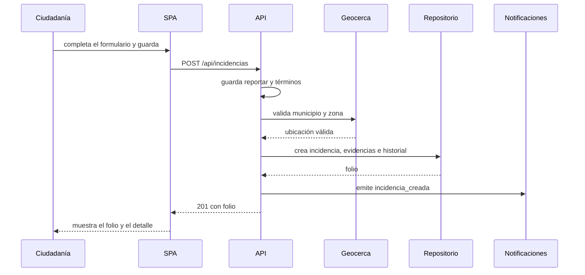

**b) Resolver y reclamar**

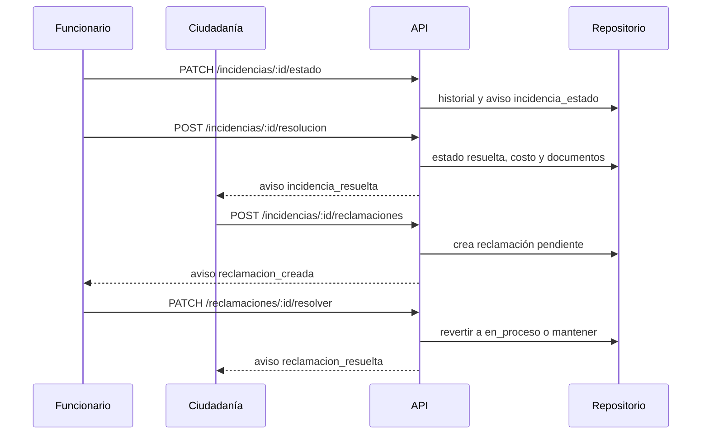

**c) Moderar una conversación reportada**

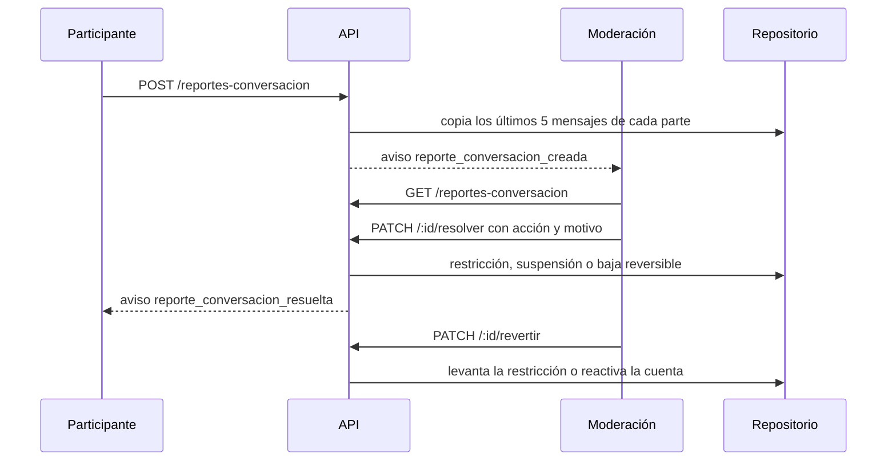

**d) Solicitudes de cuenta**

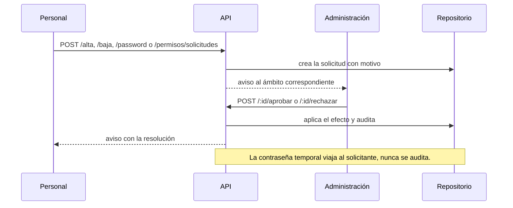

**e) Informes y descargas**

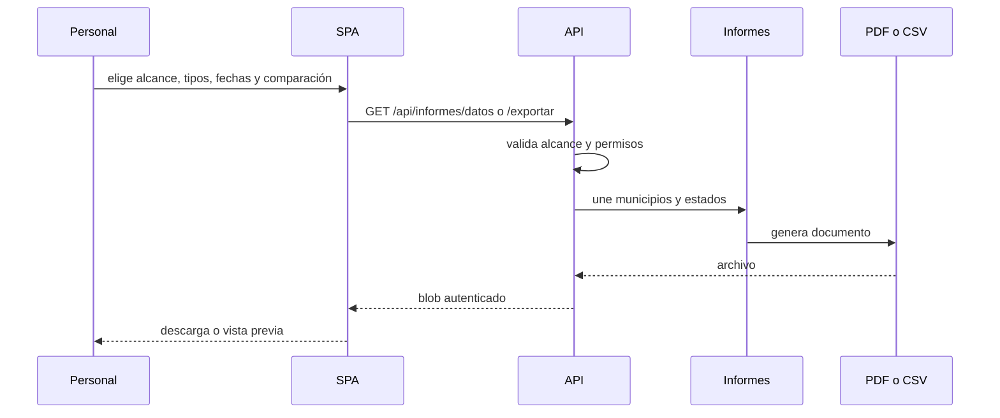

**f) Claves y sesiones**

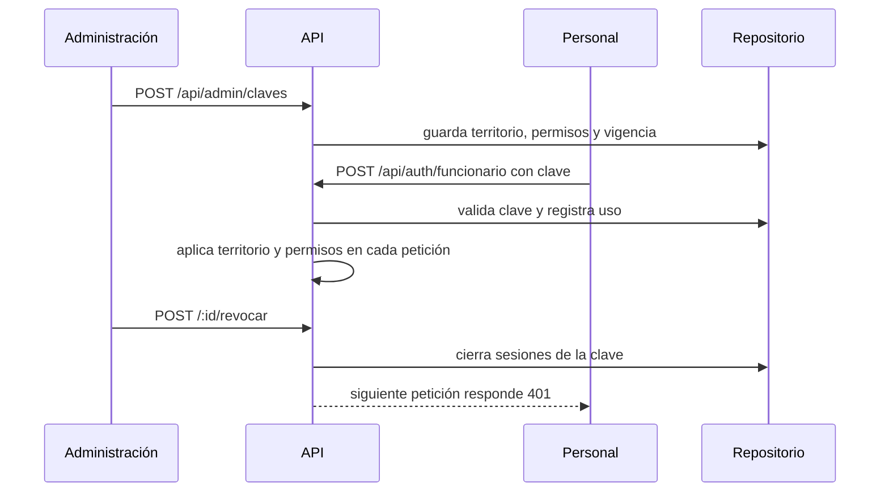

**g) Notificaciones**

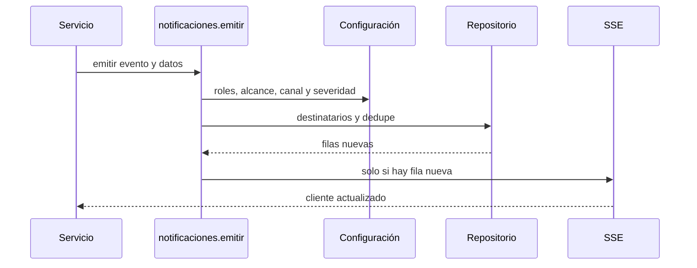

**h) Mapa sin conexión**

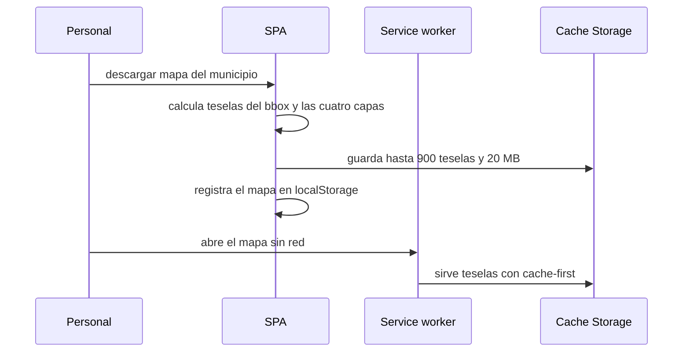

**i) Reparación de campo**

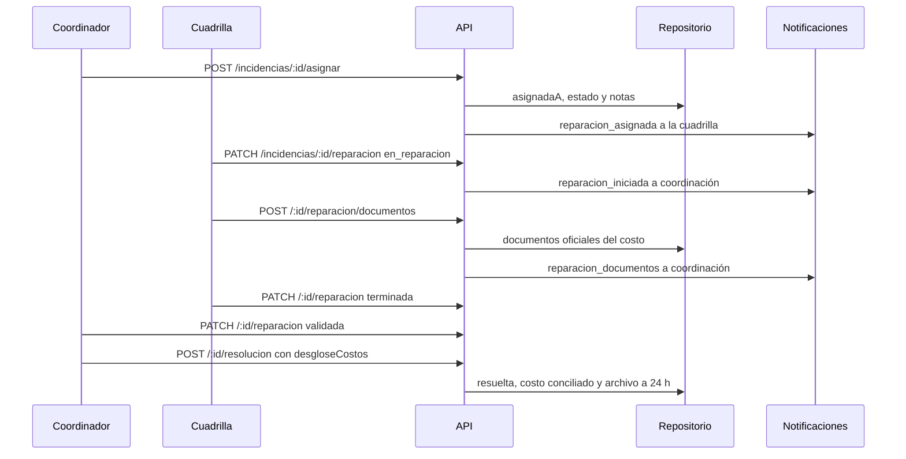

**j) Archivo y condición de vialidades**

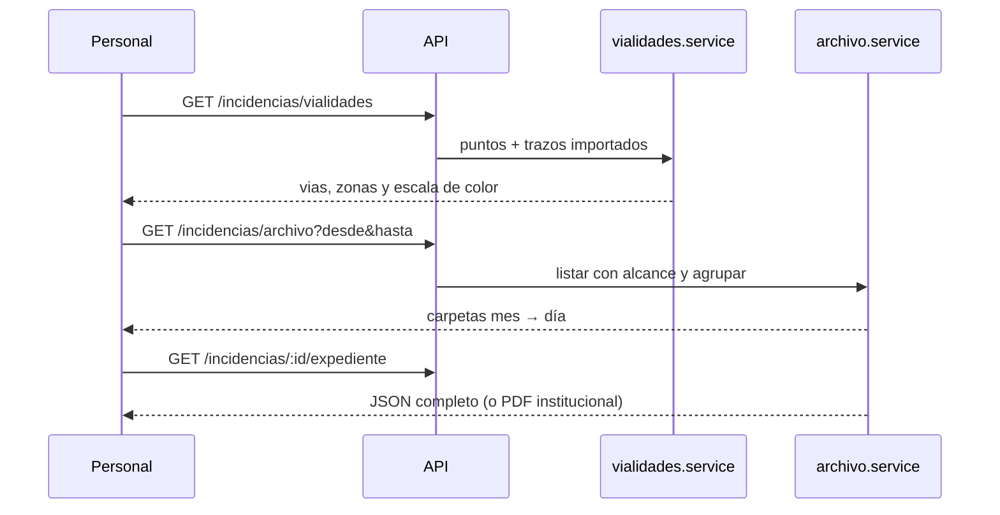

### 6.4 Eventos de notificación (71)

| Grupo | Eventos |
|---|---|
| Incidencias, sugerencias y contacto | `incidencia_creada`, `incidencia_estado`, `incidencia_resuelta`, `incidencia_comentario`, `incidencia_peligro`, `incidencia_alerta`, `sugerencia_creada`, `sugerencia_respondida`, `contacto_creado`, `contacto_respondido` |
| Solicitudes y cuentas | `solicitud_acceso_creada`, `solicitud_acceso_resuelta`, `ficha_municipio_pendiente`, `ficha_municipio_aprobada`, `ficha_municipio_rechazada`, `permiso_solicitado`, `permiso_resuelto`, `solicitud_password_creada`, `solicitud_password_resuelta`, `baja_solicitada`, `baja_resuelta`, `alta_solicitada`, `alta_resuelta`, `reporte_conversacion_creada`, `reporte_conversacion_resuelta`, `reclamacion_creada`, `reclamacion_delegada`, `reclamacion_resuelta`, `solicitud_informe_creada`, `solicitud_informe_enviada`, `solicitud_informe_error` |
| Tickets, mensajería y moderación | `ticket_creado`, `ticket_asignado`, `ticket_respondido`, `ticket_cerrado`, `ticket_reabierto`, `mensaje_directo`, `difusion_personal`, `moderacion_cuenta`, `moderacion_contenido` |
| Claves y seguridad | `clave_creada`, `clave_revocada`, `seguridad_alerta` |
| Cuenta y reparaciones | `cuenta_verificada`, `cuenta_correo_cambiado`, `cuenta_password_cambiada`, `cuenta_congelada`, `cuenta_eliminada`, `reparacion_asignada`, `reparacion_iniciada`, `reparacion_terminada`, `reparacion_documentos`, `reparacion_validada` |
| Firmas y contactos | `firma_agregada`, `meta_firmas_alcanzada`, `recoleccion_firmas_creada`, `solicitud_firmas_admin`, `documento_firmas_enviado`, `limite_firmas_alcanzado`, `contacto_funcionario_creado`, `contacto_funcionario_respondido`, `municipio_sin_funcionario`, `solicitud_funcionario_atendida` |
| Respaldos y prueba | `respaldo_creado`, `respaldo_error`, `respaldo_restaurado`, `respaldo_eliminado`, `prueba_notificacion` |

Reglas:

- Punto único: `notificaciones.service.emitir(repositorio, datos)`.
- La configuración guardada manda sobre el catálogo.
- `roles: []` exige `paraUsuarios`; sin destinatarios no hay aviso.
- `claveDedupe` evita duplicados por usuario.
- En simulación no se envía correo ni SSE real.
- Los eventos con enlace usan `panel`, `solicitud`, `baja`, `password`, `alta`, `reporte` o
  `reclamacion` para abrir el registro exacto.

### 6.5 Errores y semántica

| Código | Significado | Cuándo se usa |
|---|---|---|
| `400` | Datos inválidos. | Validación de campos o parámetros. |
| `401` | Sin sesión o sesión inválida. | Token ausente, revocado o clave vencida. |
| `403` | Autenticado sin permiso o fuera de alcance. | Permiso faltante o territorio ajeno. |
| `404` | No existe o no es visible. | Entidad inexistente u oculta. |
| `409` | Conflicto. | Correo o nombre repetido, rol con cuentas, clave duplicada. |
| `428` | Consentimiento pendiente. | Escritura sin aceptación legal vigente (`terminos_pendientes`). |
| `429` | Límite de peticiones. | Rate limit por IP o cuenta. |

El cuerpo de error es uniforme: `{ error, detalles }` (`errors.js`). Los detalles nunca
incluyen contraseñas, tokens ni claves.

---

## 7. Modelo de datos

### 7.1 Entidades principales

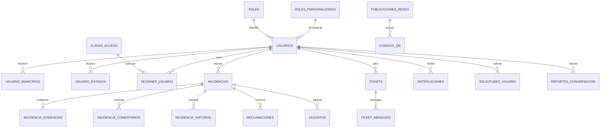

### 7.2 Grupos de tablas

| Grupo | Tablas |
|---|---|
| Catálogos | `municipios`, `zonas`, `tipos`, `municipios_informacion` |
| Cuentas y acceso | `usuarios`, `usuario_municipios`, `usuario_estados`, `roles`, `roles_personalizados`, `claves_acceso`, `clave_acceso_municipios`, `clave_acceso_estados`, `clave_notificacion_municipios`, `clave_acceso_usos`, `sesiones_usuario`, `solicitudes_acceso` |
| Incidencias | `incidencias`, `incidencia_evidencias`, `incidencia_historial`, `incidencia_comentarios`, `adjuntos`, `reclamaciones`, `denuncias`, `vialidades` |
| Comunicación | `mensajes_directos`, `mensajes_contacto`, `contactos_funcionarios`, `contacto_funcionario_destinatarios`, `contacto_funcionario_mensajes`, `solicitudes_funcionario`, `sugerencias`, `bloqueos_usuario`, `reportes_conversacion`, `restricciones_mensajes` |
| Tickets | `tickets`, `ticket_mensajes`, `ticket_eventos`, `reglas_tickets` |
| Notificaciones | `notificaciones`, `preferencias_notificacion`, `preferencia_municipios`, `preferencia_eventos`, `configuracion_notificaciones` |
| Solicitudes de personal | `solicitudes_usuario`, `solicitudes_baja`, `solicitudes_password`, `solicitudes_permisos` |
| Moderación | `restricciones_comentarios` |
| Firmas | `recolecciones_firmas`, `recoleccion_firmas`, `recoleccion_firmas_envios` |
| Informes | `solicitudes_informe` |
| Legal y configuración | `documentos_legales`, `documentos_legales_historial`, `aceptaciones_legales`, `configuracion`, `terminos` |
| Auditoría | `auditoria`, `sesiones_usuario` |
| Respaldos | `respaldos`, `respaldos_eventos` |
| Publicidad y correo | `publicaciones_redes`, `codigos_qr`, `qr_escaneos`, `correos_institucionales`, `envios_correo`, `campanas_correo`, `campana_destinatarios`, `suscripciones_correo` |
| Simulación | `simulacion_sesiones`, `simulacion_operaciones` |

### 7.3 Reglas de datos

1. Los identificadores son `string(64)`; no se usan autoincrementales en entidades nuevas.
2. Fechas con precisión de milisegundos (`DATETIME(3)`) cuando el orden importa.
3. Las tablas nuevas usan `utf8mb4` y la colación de `usuarios.id` si tienen FK a cuentas.
4. Las bajas de cuentas e incidencias son **lógicas** (`activo`, `oculto`, `archivada_en`).
5. `simulado` distingue filas del simulador; los repositorios las excluyen por defecto.
6. `clave_idempotencia` evita duplicados en reportes reintentados.
7. `password_hash` (bcrypt) verifica el acceso; `password_cifrada` (AES-256-GCM) permite
   consulta y restablecimiento auditados.
8. `TABLAS` y `COLUMNAS` en `mysql/repositorio.js` son la lista de comprobación de arranque,
   no el catálogo completo de tablas del sistema.
9. Toda tabla nueva debe registrarse en `TABLAS`; toda columna nueva, en `COLUMNAS`.
10. Las reparaciones guardan estado, notas, fechas, documentos y `desglose_costos` en la incidencia; el costo final debe coincidir con la suma del desglose.
11. `vialidades.geometria` es un GeoJSON `Polygon`/`MultiPolygon` (o `LineString` legado); `eje` conserva la línea para el degradado y `ancho_m` define el corredor. Sin filas importadas, la capa vial queda vacía con aviso; no se dibujan uniones heurísticas entre reportes.
12. `vialidades.google_maps_url`, `notas`, `verificada_en`, `verificada_por`, `activo`, `osm_id`, `bbox` y `geometria_tipo` permiten auditar la vigencia y el origen del catálogo; archivar es lógico (`activo=false`) y no borra el historial.
13. `auditoria` guarda el método HTTP; los informes filtran por `metodo`, autor, acción y rango de fechas.

---

## 8. Reglas para las migraciones

### 8.1 Principios

1. **Una migración = un cambio lógico.** No mezclar esquema, datos y semillas grandes.
2. **Nunca editar una migración ya aplicada** en otro entorno; crear una nueva.
3. **Idempotencia:** `up` y `down` deben poder ejecutarse sin romper si el objeto ya existe.
4. **Reversibilidad:** `down` deshace en orden inverso y con guardas.
5. **Sin pérdida silenciosa:** renombrar o borrar columnas con datos exige migración de datos,
   respaldo previo y ventana de mantenimiento.
6. **Respaldo antes de migrar:** `node scripts/respaldo-base.mjs --nombre=<nombre>`.
7. **Nunca** ejecutar `npm run seed` sobre una base con datos reales: es destructivo.

### 8.2 Convención de nombres

- Formato vigente: `YYYYMMDD_slug.js` (por ejemplo `20261113_resolucion_archivo_reclamaciones.js`).
- `YYYYMMDD` es la fecha de creación, no la de despliegue.
- `slug` en `snake_case`, corto y descriptivo: `solicitudes_baja`, `permisos_clave`.
- No reutilizar una fecha con otro slug ya aplicado; si hay colisión, usar el siguiente día.
- Las migraciones históricas `NNN_nombre.js` (`001`–`036`) no se renumeran ni se renombran.
- Toda migración nueva se documenta en `PROJECT_CONTEXT.md` §5 y §11.

### 8.3 Lista de comprobación

1. ¿El cambio requiere tabla, columna, índice, FK o dato sembrado? Si no, no hay migración.
2. Crear el archivo con `up` y `down` idempotentes.
3. Si hay FK a `usuarios.id`, copiar la colación con `colacionDeUsuarios(knex)`.
4. Definir `onDelete` explícito (`CASCADE`, `SET NULL` o `RESTRICT`).
5. Nombrar los índices compuestos (`tabla_campo_idx`).
6. Añadir la tabla a `TABLAS` y las columnas a `COLUMNAS` en `mysql/repositorio.js`.
7. Implementar el método en `contrato.js`, `json/repositorio.js` y `mysql/repositorio.js`.
8. Si hay permisos nuevos, sembrarlos en la misma migración para bases ya migradas.
9. Actualizar la semilla y `datos-demo` solo si el cambio lo necesita.
10. Probar `npm run migrate` en base vacía y en copia con datos.
11. Probar `npm run migrate:rollback` y volver a migrar.
12. Ejecutar la suite JSON y la prueba MySQL dirigida.
13. Actualizar `PROJECT_CONTEXT.md` §5, §11 y changelog.
14. Actualizar este documento si cambia el modelo, la API o los permisos.

### 8.4 Plantilla

```js
/** Migración: <descripción breve>. */
export async function up(knex) {
  const colacion = await colacionDeUsuarios(knex);

  if (!(await knex.schema.hasTable('mi_tabla'))) {
    await knex.schema.createTable('mi_tabla', (t) => {
      t.charset('utf8mb4');
      t.collate(colacion);
      t.string('id', 64).primary();
      t.string('usuario_id', 64).notNullable();
      t.string('estado', 24).notNullable().defaultTo('pendiente');
      t.datetime('creado_en', { precision: 3 }).defaultTo(knex.fn.now());
      t.foreign('usuario_id').references('usuarios.id').onDelete('CASCADE');
      t.index(['estado'], 'mi_tabla_estado_idx');
      t.index(['usuario_id'], 'mi_tabla_usuario_idx');
    });
  }

  if (!(await knex.schema.hasColumn('mi_tabla', 'motivo'))) {
    await knex.raw('ALTER TABLE mi_tabla ADD COLUMN motivo TEXT NULL');
  }
}

export async function down(knex) {
  if (await knex.schema.hasColumn('mi_tabla', 'motivo')) {
    await knex.raw('ALTER TABLE mi_tabla DROP COLUMN motivo');
  }
  await knex.schema.dropTableIfExists('mi_tabla');
}

async function colacionDeUsuarios(knex) {
  try {
    const [fila] = await knex('information_schema.COLUMNS')
      .select('COLLATION_NAME')
      .where({
        TABLE_SCHEMA: knex.client.config.connection.database,
        TABLE_NAME: 'usuarios',
        COLUMN_NAME: 'id'
      })
      .limit(1);
    return fila?.COLLATION_NAME || 'utf8mb4_unicode_ci';
  } catch {
    return 'utf8mb4_unicode_ci';
  }
}
```

### 8.5 Reglas técnicas

| Tema | Regla |
|---|---|
| Charset | Tablas nuevas con `t.charset('utf8mb4')`. |
| Colación | `t.collate(colacionDeUsuarios(knex))` si hay FK a `usuarios.id`. |
| Columnas en `alterTable` | Knex 3 de este repo **no** admite `t.charset()` ni `t.collate()` dentro de `alterTable`: usar `ALTER TABLE ... COLLATE ...`. |
| Índices en `alterTable` | No usar `t.index(..., { indexName })`: usar `knex.raw('ALTER TABLE ... ADD INDEX ...')`. |
| FK | `references('usuarios.id').onDelete('CASCADE')` con la misma colación. |
| Enums | En MySQL, añadir un valor a un ENUM exige `ALTER TABLE ... MODIFY COLUMN`. |
| Datos masivos | Insertar por lotes (municipios de 10, zonas de 500) para no superar `max_allowed_packet`. |
| Semillas | `seeds/` solo para base demo; no para producción. |
| Nombres | Tablas y columnas en `snake_case`; ids `string(64)`. |
| Datos legales | Versiones nuevas de términos se publican desde el panel, no con migración. |

### 8.6 Errores frecuentes

| Síntoma | Causa | Solución |
|---|---|---|
| «Falta la tabla … ejecuta npm run migrate» al arrancar | La tabla no está migrada o no está en `TABLAS`. | Migrar y registrar en `TABLAS`. |
| «Falta la columna …» al arrancar | Falta la migración o el registro en `COLUMNAS`. | Migrar y registrar en `COLUMNAS`. |
| `errno 150` al crear FK | Colación o tipo distinto de `usuarios.id`. | Copiar la colación con `colacionDeUsuarios`. |
| `max_allowed_packet` al sembrar | Un `INSERT` gigante con polígonos. | Insertar por lotes. |
| Tablas huérfanas tras un fallo | La migración se cortó a medias. | Borrar las tablas creadas y reintentar. |
| `indexName` ignorado | Knex 3 no lo admite en `t.index`. | `knex.raw('ALTER TABLE ... ADD INDEX ...')`. |
| `charset` o `collate` ignorados en `alterTable` | Limitación de Knex 3. | `ALTER TABLE ... COLLATE ...` con SQL directo. |
| `DROP DATABASE` colgado en pruebas | Conexiones o procesos de prueba vivos. | Matar los `node --test` huérfanos y reintentar. |

### 8.7 Migraciones de datos y semillas

- Las migraciones de esquema no deben depender de datos que pueden no existir.
- Si hay que rellenar una columna nueva, hacerlo con `UPDATE` por lotes y `hasColumn`.
- Sembrar roles y permisos nuevos con `INSERT ... ON DUPLICATE KEY UPDATE` o comprobación previa;
  nunca pisar matrices editadas por la administración.
- `npm run datos-nuevos` carga datos de demostración; `npm run datos-demo` carga la demo base.
- `npm run sincronizar-catalogo` actualiza municipios y zonas sin borrar usuarios ni incidencias.
- `npm run importar-legacy` y `npm run migrar-catalogo` son procesos de una sola vez.

### 8.8 Rollback y recuperación

1. `npm run migrate:rollback` revierte la última migración.
2. Si el rollback falla, restaurar el respaldo físico y revisar `knex_migrations`.
3. Nunca borrar filas de `knex_migrations` a mano sin restaurar el esquema correspondiente.
4. Tras restaurar, comprobar `TABLAS`/`COLUMNAS` arrancando el servidor.
5. Dejar constancia del incidente en el changelog de `PROJECT_CONTEXT.md`.

## 9. Reglas para crear un módulo nuevo

### 9.1 Antes de escribir código

Un módulo nuevo solo se justifica si cumple **las cuatro**:

1. Resuelve un problema real y medible (§12).
2. No lo cubre un módulo existente con una extensión menor.
3. Tiene permisos y alcance claros.
4. Se puede probar en JSON y MySQL sin datos reales.

Si falla una, no se implementa: se registra en §13 (descartado) o §14 (futuro).

### 9.2 Mapa de archivos

```text
backend/
  db/migrations/YYYYMMDD_modulo.js          ← esquema y semillas
  src/config/constantes.js                  ← permiso, CRUD, matriz
  src/config/roles.js                       ← solo si hay rol nuevo
  src/routes/modulo.routes.js               ← montaje y guardas
  src/controllers/modulo.controller.js      ← HTTP
  src/services/modulo.service.js            ← negocio, alcance y auditoría
  src/repositories/contrato.js              ← métodos nuevos
  src/repositories/json/repositorio.js      ← implementación JSON
  src/repositories/mysql/repositorio.js     ← implementación MySQL, TABLAS y COLUMNAS
  src/services/notificaciones.catalogo.js   ← evento, si aplica
  test/modulo.test.js                       ← JSON y MySQL

frontend/
  js/services/modulo.service.js             ← una función por endpoint
  js/controllers/modulo.controller.js       ← registrarAcciones
  js/views/modulo.view.js                   ← render sin API
  js/data/tutoriales.js                     ← guía, si aplica
  index.html                                ← modal, pestaña o sección
  css/                                      ← estilos por clase
  sw.js                                     ← precarga y versión del shell
```

### 9.3 Backend

1. **Permiso:** definir `ver_modulo`, `crear_modulo`, `editar_modulo`, `eliminar_modulo`
   (o el verbo que corresponda) en `constantes.js` y en `frontend/js/data/permisos.js`.
2. **Matriz:** añadir a `PERMISOS_POR_ROL` con el mínimo privilegio; si hay CRUD, a
   `PERMISOS_CRUD`; si hay paraguas heredado, a `PERMISOS_UMBRELLA`.
3. **Migración:** crear tablas y sembrar permisos en `roles` para bases existentes.
4. **Registro:** añadir la tabla a `TABLAS` y las columnas a `COLUMNAS`.
5. **Contrato:** declarar los métodos en `contrato.js` **antes** de implementarlos.
6. **Drivers:** implementar en `json/repositorio.js` y `mysql/repositorio.js` con la misma firma.
7. **Servicio:** validar datos, aplicar alcance, comprobar autorización fina, auditar y emitir
   eventos. El servicio no conoce `req` ni `res`.
8. **Controlador:** traducir HTTP a servicio y devolver el código correcto.
9. **Router:** montar bajo `/api`, aplicar `requiereSesion` o `requierePermiso` por ruta.
10. **Pruebas:** cubrir permiso, alcance, validación, duplicados y baja lógica.

### 9.4 Frontend

1. **Servicio:** una función por endpoint; nunca `fetch` directo en la vista.
2. **Controlador:** orquesta store, servicio y vista; registra las acciones.
3. **Vista:** solo renderiza; usa `esc()` para texto y no llama a la API.
4. **HTML:** un modal o panel con id estable; botones con `data-action`.
5. **Permisos:** `data-permiso` en la pestaña o sección y ocultado con `puede()`.
6. **Estados:** vacío, cargando, error, sin permiso y sin conexión.
7. **CSS:** clases, nunca estilos inline; comprobar móvil, laptop y TV.
8. **Accesibilidad:** foco al abrir, cierre con Escape, etiquetas y `role` adecuados.
9. **Offline:** si el módulo debe funcionar sin red, añadirlo al service worker y subir la
   versión del shell (`incidencias-shell-vX.Y.Z`).
10. **Tutorial:** si el flujo es nuevo, añadir una guía con un paso de simulación no destructivo.

### 9.5 Datos, eventos y auditoría

- Toda escritura pasa por `auditar` (automático) y, si es una decisión sensible, por
  `registrarAccion(req, { accion, entidad, entidadId, detalle })`.
- Toda notificación se emite con `notificaciones.emitir()` y un evento del catálogo.
- Si el evento necesita enlace, incluir `url` con el panel y el id del registro.
- Si el módulo se puede simular, añadirlo a `ACCIONES_SIMULACION` y a las tablas simuladas.
- Nunca guardar contraseñas, tokens ni claves en auditoría, notificaciones o logs.

### 9.6 Pruebas obligatorias

| Nivel | Qué debe cubrir |
|---|---|
| JSON | Camino feliz, permisos, alcance, validación y duplicados. |
| MySQL | Los mismos casos cuando haya persistencia nueva. |
| UI estática | Modales, acciones, `data-permiso`, CSP y sintaxis de módulos. |
| Regresión | Suite completa sin fallos. |

### 9.7 Definición de terminado

- [ ] Permiso y matriz actualizados en backend y frontend.
- [ ] Migración aplicada, reversible y documentada.
- [ ] `TABLAS`/`COLUMNAS` actualizados.
- [ ] Contrato y ambos drivers implementados.
- [ ] Ruta con guarda y servicio con autorización fina.
- [ ] Vista, controlador y acciones registradas.
- [ ] `data-permiso` y ocultado en cliente.
- [ ] Evento de notificación y auditoría si aplica.
- [ ] Pruebas JSON y MySQL en verde.
- [ ] `PROJECT_CONTEXT.md` y `SISTEMA_COMPLETO.md` actualizados.
- [ ] Changelog con fecha.
- [ ] Sin `style`, `<style>`, `onclick` ni scripts inline.

---

## 10. Reglas para permisos, roles y vistas nuevas

### 10.1 Permisos nuevos

1. **Nombre:** `ver_x`, `crear_x`, `editar_x`, `eliminar_x` para CRUD; verbos específicos
   (`aprobar_x`, `rechazar_x`, `revelar_x`) solo cuando el CRUD no represente la acción.
2. **Un permiso = una capacidad.** No se reutiliza un permiso para otra cosa ni se crea uno
   para ocultar un botón.
3. **Sincronización obligatoria:** `constantes.js`, `frontend/js/data/permisos.js`,
   `permisos-ayuda.js` y este documento.
4. **Roles:** añadirlo a la matriz de los roles que realmente lo necesiten; el resto, por
   excepción o solicitud.
5. **Bases existentes:** sembrarlo con una migración idempotente en `roles` y en las cuentas
   que ya debían tenerlo (ver `20261107_roles_permisos_v211.js`).
6. **Rutas:** `requierePermiso('x')` por ruta; nunca un `router.use` que bloquee módulos
   vecinos.
7. **Servicio:** repetir la comprobación y aplicar alcance.
8. **UI:** `data-permiso` en pestañas y `puede('x')` en botones.
9. **Prueba:** un caso con el permiso y otro sin él.
10. **Prohibido:** conceder permisos que el actor no tiene (`permisosOtorgables`) salvo al
    administrador maestro.

### 10.2 Roles nuevos

Antes de crear un rol, agotar estas opciones:

1. **Rol propio** (`roles.tipo='propio'`): misma plantilla, matriz distinta.
2. **Rol especial** (`roles_personalizados`): suma permisos a un rol base.
3. **Excepción de cuenta** (`usuarios.permisos`): caso puntual.

Solo si ninguna sirve, crear un rol del sistema. En ese caso:

1. Añadir a `ROLES` (ENUM en MySQL) y a `ROLES_PERSONAL` si entra al panel.
2. Añadir a los grupos que correspondan (`ROLES_ADMIN`, `ROLES_ATENCION`, `ROLES_LECTURA`).
3. Añadir a `ROLES_INTEGRADOS` con etiqueta y territorio (`municipios`, `estados` o `ambos`).
4. Definir su matriz en `PERMISOS_POR_ROL`.
5. Revisar `puedeEscribirDe` y `alcanceDe`.
6. Revisar las rutas de acceso (`/auth/funcionario`, `/auth/admin`).
7. Revisar los filtros de tutoriales y de la interfaz.
8. Crear migración para el ENUM y la semilla de `roles`.
9. Probar login, alcance, escritura y panel.
10. **Nunca** añadir `admin` a `ROLES_INTEGRADOS`: siempre tiene todo por código.

Reglas de integridad:

- Un rol integrado no se elimina ni se desactiva.
- Un rol propio con cuentas asignadas no se elimina (409): primero se reasignan.
- Los roles propios no pueden basarse en administración.
- `usuarios.rol` sigue siendo la plantilla para los guards; el rol propio se guarda aparte.

### 10.3 Vistas nuevas

1. **Reutilizar antes de crear:** si cabe en un modal existente, no se crea otra vista.
2. **Registro:** la vista se declara en `index.html` y se pinta desde un controlador.
3. **Apertura:** `abrirModal(id)`; anidada con `{ nested: true }`; cierre con `modal:cerrar`.
4. **Capas:** respetar la escala de z-index (§4.8) y no tapar toast ni carga.
5. **Permisos:** si es pestaña, `data-permiso`; si es modal, comprobar al abrir y en servidor.
6. **Estados:** cargando, vacío, error, sin permiso y sin conexión.
7. **Formularios:** `required`, `minlength`, bloqueo del botón mientras se envía y mensaje en
   línea; el servidor repite la validación.
8. **Enlaces profundos:** si la vista debe abrirse desde un aviso o correo, registrar el
   parámetro en `main.js` y en `navegarAlOrigen()`.
9. **Offline:** si aplica, precargar el módulo en `sw.js` y subir la versión del shell.
10. **Pruebas:** contrato estático de HTML, acciones y permisos.

### 10.4 Pestañas del panel

Para añadir una pestaña:

1. Añadir el botón `data-action="admin:tab"` con `data-valor` y `data-permiso`.
2. Añadir el contenedor `#panel-<valor>`.
3. Registrar el mapeo en `PERMISO_POR_TAB` de `admin.controller.js`.
4. Crear la función de render y cargarla al abrir la pestaña.
5. Añadir la guarda en el router del módulo.
6. Actualizar §4.5 y el catálogo de tutoriales.
7. Ejecutar `permisos-panel.test.js` y `sistema-documentado.test.js`.

### 10.5 Anti-patrones prohibidos

- Crear un permiso para esconder un botón que el servidor ya permite.
- Crear una pestaña sin guarda en el servidor.
- Crear un rol nuevo para un caso puntual que cabe en una excepción.
- Duplicar una vista en lugar de parametrizar la existente.
- Añadir `data-action` sin manejador.
- Usar `style`, `onclick` o `<script>` inline.
- Conceder permisos por `gestionar_*` nuevos sin migración.

---

## 11. Reglas de CRUD

### 11.1 Contrato por verbo

| Verbo | Permiso | Éxito | Errores esperados | Auditoría | Notificación | UI |
|---|---|---|---|---|---|---|
| `GET` lista | `ver_x` | `200` | `401`, `403` | No | No | Tabla con filtros y paginación. |
| `GET` detalle | `ver_x` | `200` | `401`, `403`, `404` | No | No | Modal o ficha. |
| `POST` crear | `crear_x` | `201` | `400`, `403`, `409`, `428` | Sí | Según evento | Botón «Nuevo» visible con permiso. |
| `PATCH` editar | `editar_x` | `200` | `400`, `403`, `404`, `409` | Sí | Según evento | Formulario precargado. |
| `DELETE` baja | `eliminar_x` | `200` | `403`, `404`, `409` | Sí | Según evento | Confirmación previa. |
| Acción especial | permiso propio | `200` | `400`, `403`, `404` | Sí | Según evento | Botón con confirmación. |

### 11.2 Reglas de negocio

1. **Validación doble:** cliente y servidor. El servidor nunca confía en el cliente.
2. **Alcance:** toda consulta de personal se filtra con `filtrosDeAlcance`; toda escritura
   valida el territorio con `exigirMunicipioDeAlcance`.
3. **Baja lógica:** cuentas (`activo=false`), incidencias (`oculto`, `archivada_en`) y
   catálogos con uso. El borrado físico solo para registros sin dependencias.
4. **Duplicados:** `409` con mensaje entendible; traducir `ER_DUP_ENTRY` de MySQL.
5. **Idempotencia:** los reportes aceptan `clave_idempotencia` y no duplican al reintentar.
6. **Términos:** cualquier escritura sin aceptación vigente responde `428`.
7. **Escalada:** nadie concede permisos que no tiene; solo el maestro.
8. **Administradores:** un funcionario nunca crea ni edita cuentas administrativas.
9. **Contraseñas:** nunca se devuelven en listados, auditoría ni notificaciones.
10. **Paginación:** listas grandes con límite y filtros; evitar cargar polígonos si no se usan.
11. **Auditoría:** toda escritura queda registrada y saneada.
12. **Eventos:** emitir después de persistir; nunca antes.
13. **Simulación:** si el módulo participa, respetar `AsyncLocalStorage` y `simulado`.
14. **Eliminación:** comprobar dependencias y responder `409` antes de romper FKs.

### 11.3 Matriz de pruebas CRUD

| Caso | JSON | MySQL | Qué valida |
|---|---|---|---|
| Listar con permiso | Sí | Sí | `200` y filtros de alcance. |
| Listar sin permiso | Sí | Sí | `403`. |
| Crear válido | Sí | Sí | `201`, persistencia y auditoría. |
| Crear duplicado | Sí | Sí | `409` con mensaje. |
| Crear fuera de alcance | Sí | Sí | `403`. |
| Editar válido | Sí | Sí | `200` y cambios. |
| Editar sin permiso | Sí | Sí | `403`. |
| Eliminar / baja lógica | Sí | Sí | Estado final y `409` si hay dependencias. |
| Términos pendientes | Sí | Opcional | `428`. |
| Simulación | Sí | Opcional | No emite SSE ni correo real. |

### 11.4 Lista de comprobación CRUD

- [ ] Ruta con el verbo y el permiso correctos.
- [ ] Servicio con validación, alcance y autorización fina.
- [ ] Repositorio con el método en contrato y ambos drivers.
- [ ] Respuestas `200/201/204`, `400`, `403`, `404`, `409`, `428` según corresponda.
- [ ] Auditoría sin datos sensibles.
- [ ] Evento de notificación si el cambio lo merece.
- [ ] UI con botones condicionados por permiso.
- [ ] Pruebas JSON y MySQL.
- [ ] Documentación actualizada.

---

## 12. ¿Es realmente necesario? Puerta de decisión

### 12.1 Preguntas guía

| # | Pregunta | Por qué importa |
|---:|---|---|
| 1 | ¿Qué problema concreto resuelve y a quién? | Sin usuario y problema, no hay prioridad. |
| 2 | ¿Cuántas personas lo usarán y con qué frecuencia? | Un uso anual no justifica un módulo. |
| 3 | ¿Qué se hace hoy sin la función? | Si el sustituto es aceptable, no se construye. |
| 4 | ¿Qué pasa si no se implementa? | Si la respuesta es «nada», no es urgente. |
| 5 | ¿Se puede resolver con un permiso, una vista o un campo? | La mayoría de las ideas no necesitan módulo. |
| 6 | ¿Ya existe algo parecido en el sistema? | Duplicar vistas y endpoints multiplica el mantenimiento. |
| 7 | ¿Qué datos nuevos requiere y quién es su dueño? | Tablas nuevas implican migración, respaldo y privacidad. |
| 8 | ¿Afecta permisos, roles o alcance territorial? | Es el cambio más caro y el más sensible. |
| 9 | ¿Tiene implicaciones legales o de privacidad? | Datos personales, consentimiento y retención. |
| 10 | ¿Cómo se mide el éxito? | Sin métrica no se puede decidir si funcionó. |
| 11 | ¿Cómo se revierte si falla? | Si no hay rollback, el riesgo es alto. |
| 12 | ¿Quién lo mantiene y quién da soporte? | Una función sin dueño se abandona. |
| 13 | ¿Cuánto cuesta en pruebas, migración y documentación? | El código es la parte barata. |
| 14 | ¿Se puede lanzar detrás de un permiso o una bandera? | Reduce el riesgo y permite medir. |

### 12.2 Semáforo de decisión

| Resultado | Cuándo | Qué hacer |
|---|---|---|
| **Implementar** | Problema claro, uso frecuente, bajo riesgo y alcance definido. | Pasar por §9 y §11. |
| **Prototipar** | Valor plausible pero incierto. | Versión mínima detrás de un permiso o bandera. |
| **Postergar** | Valor real pero depende de datos, terceros o presupuesto. | Registrar en §14 con condición de activación. |
| **Descartar** | Duplica algo existente, no hay usuario o el riesgo supera el valor. | Registrar en §13 con motivo. |

### 12.3 Ejemplos prácticos

| Idea | Análisis | Decisión recomendada |
|---|---|---|
| Avisos por WhatsApp | Canal nuevo, costo por mensaje, datos personales y soporte. La app y el correo ya cubren el aviso. | **Postergar** hasta medir cuántos avisos no se leen. |
| Chatbot con IA para redactar reportes | Mejora la calidad, pero envía texto a un tercero y añade costo y latencia. | **Prototipar** detrás de un permiso y con datos anonimizados. |
| App móvil nativa | La PWA ya es instalable y tiene mapas offline. Una app nativa duplica tiendas y versiones. | **Descartar** salvo requisito de cámara o push que la PWA no cubra. |
| Exportar a Excel | El CSV ya existe y Excel lo abre; un XLSX real añade una dependencia. | **Implementar** como variante de bajo costo reutilizando `/api/informes/exportar`. |
| Firma electrónica avanzada | Requiere proveedor, cumplimiento y custodia. La firma actual es de apoyo. | **Postergar** con evaluación legal previa. |
| Tema oscuro | Ya se retiró en V2.11.1 por duplicar CSS y pruebas. La interfaz es clara fija. | **Descartar** salvo requisito de accesibilidad concreto. |
| Mapa de calor en vivo | Alto costo de agregación y teselas; las estadísticas ya comparan territorios. | **Postergar** hasta tener volumen que lo justifique. |
| Nuevo rol «supervisor» | Se puede resolver con rol propio o excepción de cuenta. | **Descartar** el rol nuevo; usar rol propio. |

### 12.4 Señales de alarma

- La idea cambia tres módulos para resolver un caso aislado.
- Se necesita un permiso nuevo para que «solo algunos» vean un botón.
- Se duplica una tabla para guardar dos campos.
- El flujo exige cinco clics y dos modales anidados.
- Nadie sabe qué métrica mejorará.
- La función solo la usará una persona una vez al año.
- Se pospone la migración «para después».
- No hay forma de desactivarla si falla.

### 12.5 Plantilla de propuesta

```text
Idea:
Problema y usuario:
Uso esperado (personas y frecuencia):
Alternativa actual:
¿Qué pasa si no se hace?:
Datos nuevos y dueño:
Permisos, roles y alcance:
Riesgos legales y de privacidad:
Métrica de éxito:
Esfuerzo estimado (días):
Dependencias:
Rollback:
Decisión: implementar / prototipar / postergar / descartar
```

---

## 13. Ideas descartadas

Registrar aquí **solo** decisiones cerradas. Cada fila debe explicar el motivo y la condición
para reconsiderarla; si no hay condición, se escribe «ninguna».

| Idea | Fecha | Motivo | Condición para reconsiderar |
|---|---|---|---|
| Tema claro/oscuro y `data-theme` | 2026-10-30 (V2.11.1) | Duplicaba CSS, pruebas y contraste; se retiraron `tema.js`, `tema-publico.js`, `tema-oscuro.css` y los controles. | Un requisito de accesibilidad o de marca que lo exija. |
| Capa «terreno» de Esri | 2026-10-27 (V2.3) | El proveedor devolvía «map data not yet available». | Un proveedor de teselas de terreno estable. |
| Páginas independientes `/informes` y `/tickets` | 2026-10-29 (V2.6) | Se sustituyeron por modales y redirecciones con enlace profundo. | Ninguna; los enlaces antiguos se conservan. |
| `onclick`, `style` inline y `<style>` | CSP estricta | Prohibidos por seguridad; los tests `sin-estilos-inline` los bloquean. | Ninguna. |
| Permiso nuevo para ocultar un botón ya protegido | 2026-10-31 | El servidor ya autoriza; el permiso extra solo añade mantenimiento. | Que la capacidad sea realmente distinta. |
| — | — | — | — |

Reglas para añadir una fila:

1. Una idea por fila.
2. Fecha y versión en que se descartó.
3. Motivo verificable, no una opinión.
4. Condición objetiva para revisarla.
5. Si se reconsidera, mover la fila a §14 o eliminarla y dejar la decisión en el changelog.

---

## 14. Ideas de implementación futura

| Idea | Valor | Esfuerzo | Riesgos | Dependencias | Estado |
|---|---|---|---|---|---|
| Completar `TABLAS` y `COLUMNAS` con todas las tablas usadas | Alto | Bajo | Bajo | Migraciones existentes | Propuesta |
| Unificar la ruta duplicada de comentarios | Medio | Bajo | Bajo | Pruebas de incidencias | Propuesta |
| Decidir si `responder_tickets` es guard real o se retira | Medio | Bajo | Medio | Matriz de permisos | En análisis |
| Implementar o retirar `editar_tipos` | Bajo | Bajo | Bajo | Catálogo de tipos | Propuesta |
| Guarda explícita para `ver_zonas` y `gestionar_zonas` | Medio | Medio | Bajo | Rutas de catálogos | Propuesta |
| Test global de `data-action` con manejador registrado | Alto | Medio | Bajo | `eventos.js` y tests de UI | Propuesta |
| Exportación XLSX reutilizando el constructor de informes | Medio | Bajo | Bajo | `informes/exportar` | Propuesta |
| Notificaciones push web | Medio | Medio | Medio | Service worker y permisos del navegador | En análisis |
| Avisos por WhatsApp | Alto | Alto | Alto | Proveedor, costo y privacidad | Postergada |
| Firma electrónica avanzada | Medio | Alto | Alto | Proveedor y marco legal | Postergada |
| Auditoría de accesibilidad WCAG AA | Alto | Medio | Bajo | Revisión de todas las vistas | Propuesta |
| Multilenguaje español/inglés | Bajo | Alto | Medio | Catálogo de textos | Descartada por ahora |
| Versionado de API `/api/v1` | Medio | Alto | Medio | Compatibilidad de clientes | Postergada |
| Límite de peticiones por cuenta, no solo por IP | Medio | Medio | Bajo | `limitadores.js` | Propuesta |

Prioridad sugerida: primero la deuda técnica de §15.3 (bajo esfuerzo, alto impacto), después
los tests de contrato, luego las mejoras de informes y por último los canales externos.

---

## 15. Apéndices

### 15.1 Glosario

| Término | Significado |
|---|---|
| **Alcance** | Territorio que una cuenta puede ver o modificar. |
| **Paraguas** | Permiso antiguo que se expande a varios permisos CRUD. |
| **Clave de acceso** | Credencial que fija territorio, permisos y vigencia a una sesión de personal. |
| **Rol propio** | Rol configurable que sustituye la matriz de una plantilla. |
| **Rol especial** | Conjunto de permisos extra sumado a un rol base. |
| **Simulación** | Ejecución etiquetada que no emite SSE ni correo y se puede revertir. |
| **Baja lógica** | Desactivar sin borrar (`activo=false`, `oculto`, `archivada_en`). |
| **Shell offline** | Armazón de la PWA guardado por el service worker. |
| **Tesela** | Pieza del mapa que se descarga y cachea. |
| **DoD** | Definición de terminado. |

### 15.2 Comandos

| Comando | Uso |
|---|---|
| `npm run dev` | Servidor de desarrollo. |
| `npm test` | Suite JSON. |
| `npm run test:mysql` | Suite MySQL con Docker (3399) o MariaDB local (3306). |
| `npm run db:pruebas` | Crear y migrar `incidencias_pruebas`. |
| `npm run db:pruebas:down` | Bajar el contenedor de pruebas. |
| `npm run migrate` | Migraciones pendientes. |
| `npm run migrate:rollback` | Revertir la última. |
| `npm run seed` | Semilla demo (**destructiva**). |
| `npm run datos-nuevos` | Datos de demostración V2.2. |
| `npm run verificar-funciones` | Flujos reales contra la base configurada. |
| `npm run limpiar-bases-prueba` | Borrar bases temporales de prueba. |
| `npm run sincronizar-catalogo` | Actualizar municipios y zonas sin borrar datos. |
| `npm run importar-inegi` | Regenerar el catálogo nacional. |
| `node scripts/respaldo-base.mjs --nombre=<nombre>` | Respaldo físico previo a migrar. |

### 15.3 Deuda técnica detectada

Hallazgos de la auditoría de este documento. **No se corrigen aquí**; se registran para
priorizarlos.

| # | Hallazgo | Impacto | Recomendación |
|---:|---|---|---|
| 1 | `TABLAS` no incluye todas las tablas que usa el driver MySQL. | La validación de arranque no cubre todo el esquema. | Completar la lista o generar la comprobación desde las migraciones. |
| 2 | `solicitudes_informe` está en `COLUMNAS` pero no en `TABLAS`. | Inconsistencia de validación. | Añadirla a `TABLAS`. |
| 3 | `responder_tickets` se declara pero el servicio usa `atender_tickets`. | Permiso que promete algo que no hace. | Definir si es alias o retirarlo. |
| 4 | `editar_tipos` está reservado y no aparece en la matriz. | Permiso muerto. | Implementarlo o eliminarlo. |
| 5 | `ver_zonas` y `gestionar_zonas` no tienen guarda explícita en todas las rutas. | Riesgo de acceso indirecto. | Añadir guardas y pruebas. |
| 6 | `ROLES_ESCRITURA` no coincide con `puedeEscribirDe`. | Confusión al leer el código. | Documentar o alinear. |
| 7 | El comentario de `repositories/index.js` sugiere JSON por defecto, pero `config` usa MySQL. | Arranque inesperado en local. | Corregir el comentario o el valor por defecto. |
| 8 | No hay test que valide `data-action` contra manejadores registrados. | Acciones silenciosamente muertas. | Añadir el test global. |
| 9 | No hay test que compare las migraciones con `PROJECT_CONTEXT.md`. | Documentación desactualizada. | Añadir un test de inventario. |
| 10 | Eventos con `roles: []` no avisan si falta `paraUsuarios`. | Avisos que se pierden sin error. | Validar en `emitir` y en pruebas. |
| 11 | El tamaño del documento y del catálogo de acciones invita a divergir. | Mantenimiento manual. | Mantener `sistema-documentado.test.js` y revisar en cada versión. |

### 15.4 Changelog de este documento

| Fecha | Cambio |
|---|---|
| 2026-10-31 | Creación del documento: diagramas, inventarios de vistas y acciones, permisos, flujos, reglas de migraciones, módulos, permisos, roles, vistas y CRUD, puerta de decisión, ideas descartadas y backlog. |

---

> **Mantenimiento:** al cerrar una versión, revisar §0.2 (cifras), §4 (vistas y pestañas),
> §5 (dominios), §3 (permisos y roles), §8 (migraciones) y §15.3 (deuda técnica). Ejecutar
> `cd backend && node --test test/sistema-documentado.test.js` antes de dar el cambio por terminado.


